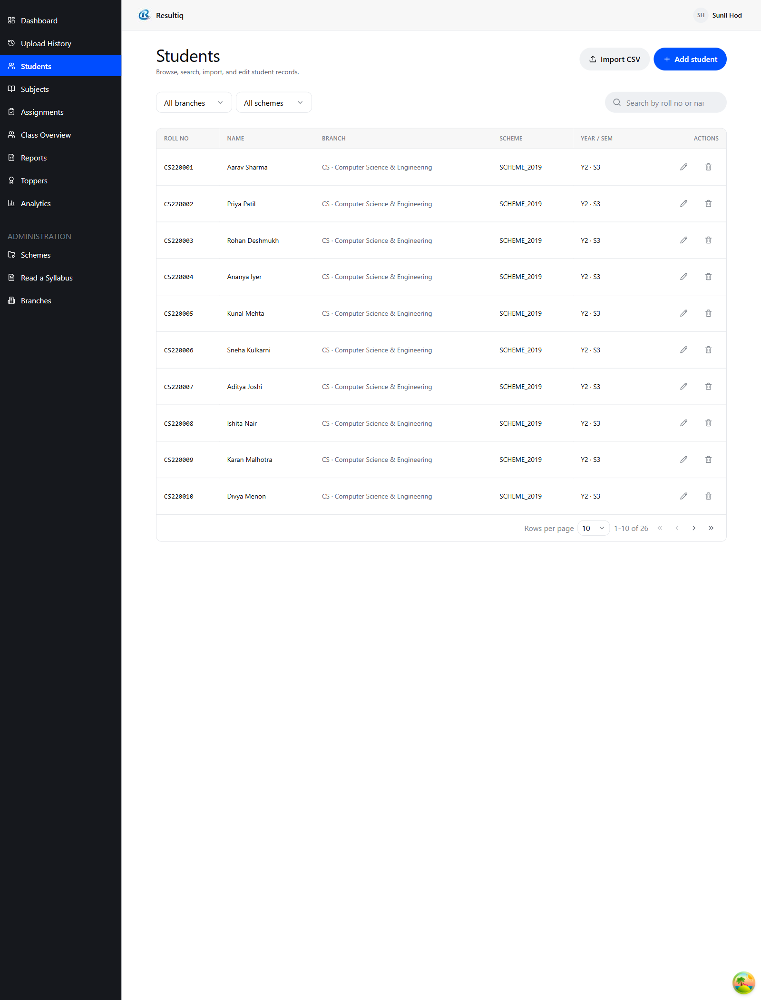
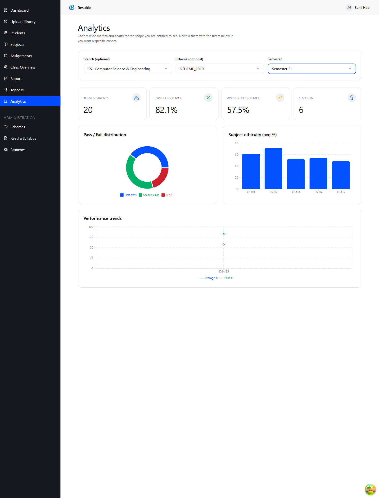
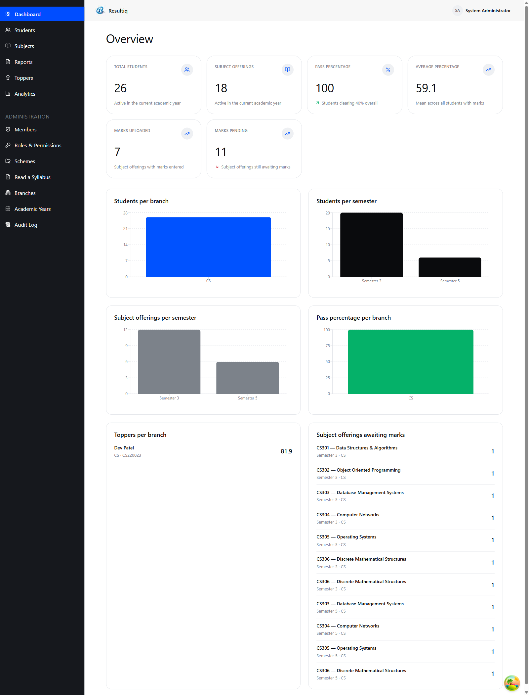
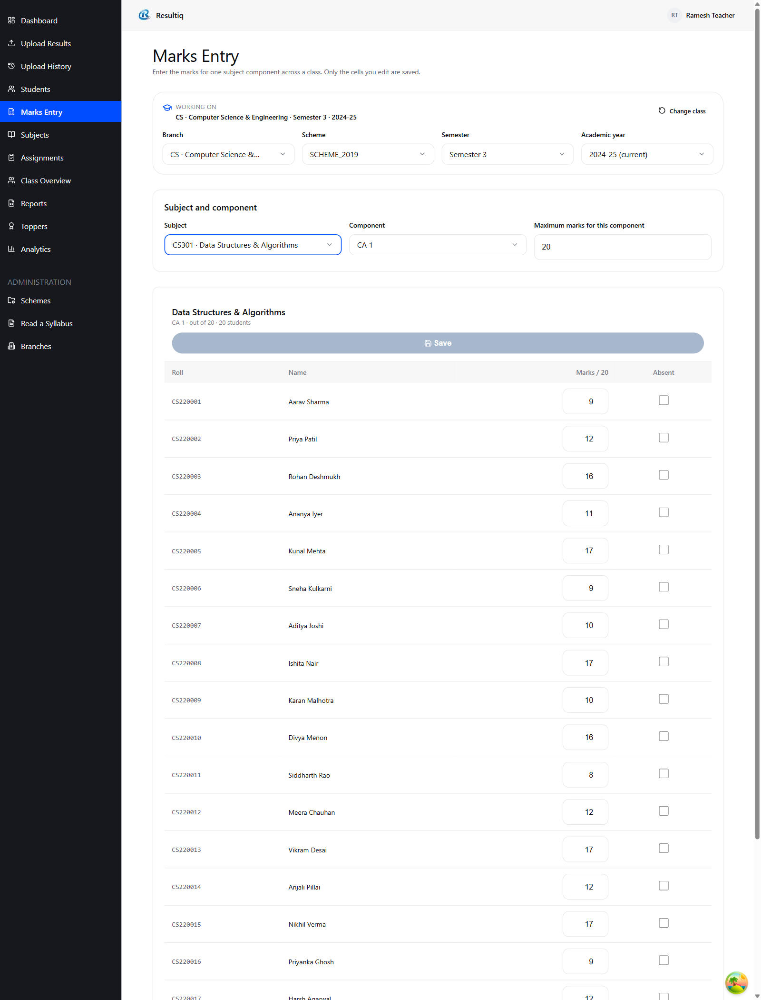
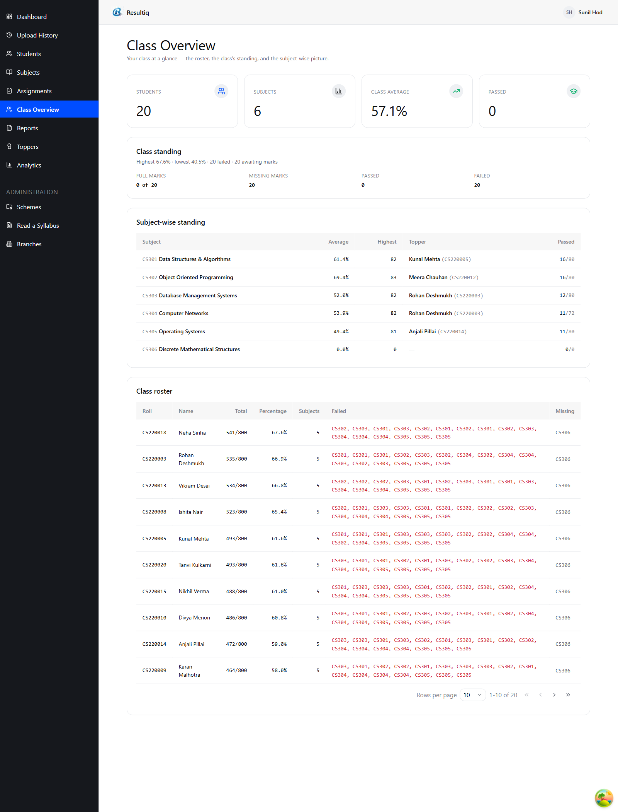
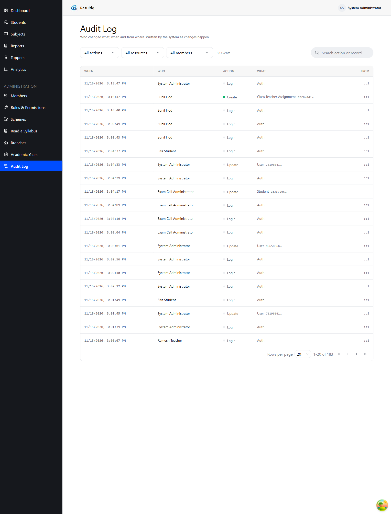
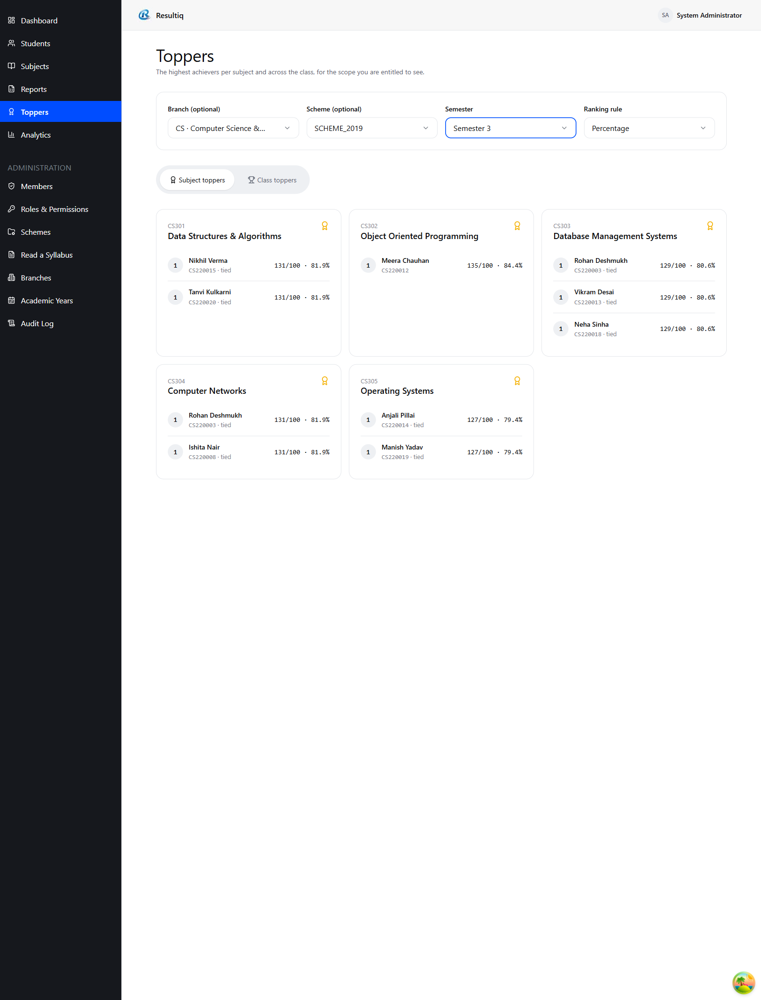

# Table of Content

| Chapter       | Title                                        | Page   |
| ------------- | -------------------------------------------- | ------ |
|               | Table of Content                             | i      |
|               | Organization of this Project                 | ii     |
|               | List of Glossary                             | iii    |
|               | List of Tables                               | iv     |
|               | List of Figures                              | v      |
|               | List of Graphs                               | vi     |
| **Chapter 1** | **Introduction &amp; Problem Definition**    | **1**  |
| 1.1           | Problem Statement                            | 1      |
| 1.2           | Objectives                                   | 3      |
| 1.3           | Scope of the Project                         | 4      |
| 1.4           | Methodology Overview                         | 5      |
| **Chapter 2** | **Literature Survey (Existing System)**      | **7**  |
| 2.1           | Overview of Existing System                  | 7      |
| 2.2           | Limitations of Existing System               | 9      |
| 2.3           | Proposed System                              | 12     |
| 2.4           | Feasibility Study                            | 14     |
| **Chapter 3** | **System Analysis**                          | **17** |
| 3.1           | Requirement Analysis                         | 17     |
| 3.2           | Functional &amp; Non-Functional Requirements | 19     |
| 3.3           | Data Flow Diagrams / Use Case Models         | 22     |
| 3.4           | Requirement Specifications (SRS Format)      | 24     |
| **Chapter 4** | **System Design**                            | **30** |
| 4.1           | System Architecture                          | 30     |
| 4.2           | Database Design (E-R Diagram)                | 33     |
| 4.3           | Interface Design                             | 36     |
| 4.4           | UML Diagrams (Class, Sequence, Activity)     | 39     |
| **Chapter 5** | **Implementation &amp; Testing**             | **43** |
| 5.1           | Technology Stack Used                        | 43     |
| 5.2           | Implementation Details                       | 45     |
| 5.3           | Testing Strategy                             | 49     |
| 5.4           | Test Cases and Results                       | 52     |
| **Chapter 6** | **Results and Discussion**                   | **55** |
| 6.1           | Output Screens / System Snapshots            | 55     |
| 6.2           | Performance Evaluation                       | 58     |
| 6.3           | Discussion of Results                        | 61     |
| **Chapter 7** | **Conclusion and Future Scope**              | **64** |
| 7.1           | Conclusion                                   | 64     |
| 7.2           | Future Enhancement                           | 66     |
|               | Preferences (in Details)                     | 67     |
|               | References (in IEEE Format)                  | 69     |

---

# Organization of this Project

This report is organised into seven chapters, followed by a detailed bibliography and a numbered reference list. The chapters follow the conventional order of software engineering documentation: the problem and its scope are established before the analysis, the analysis is resolved into a design, the design is realised and verified, and the results are discussed against the objectives stated at the outset.

**Chapter 1 — Introduction &amp; Problem Definition** establishes the domain and the problem. It states the problem as it is actually encountered in an engineering college examination cell, lists the ten objectives against which the finished system is assessed, defines what the system does and does not cover, and describes the development methodology that was followed to build it.

**Chapter 2 — Literature Survey (Existing System)** examines how result processing is carried out today. It describes manual, spreadsheet-based, university-portal and commercial college-management approaches, enumerates the twelve limitations of those approaches, sets out the proposed system against them in a comparison table, and presents the feasibility study under technical, economic and legal headings.

**Chapter 3 — System Analysis** turns the study into requirements. It records the requirement-gathering activity, separates functional from non-functional requirements, presents the three-level data flow decomposition and the use case model, and closes with a full software requirements specification covering purpose, scope, definitions, constraints, interfaces and a tabulated requirement set with verification methods.

**Chapter 4 — System Design** resolves the requirements into a structure. It describes the layered architecture and its cross-cutting concerns, the database design with its entity relationship model and integrity strategy, the interface design at the component and screen level, and the unified modelling language views — class, sequence and activity — that describe the system's internal structure and behaviour.

**Chapter 5 — Implementation &amp; Testing** records how the system was built and how it was verified. It gives the technology stack with the reason each layer was chosen, describes the eleven implementation decisions that shape the system's behaviour, sets out the four-level testing strategy with its stated limitations, and presents thirty-four executed test cases with their observed results.

**Chapter 6 — Results and Discussion** presents what the system produces. It illustrates the eight principal screens with an explanation of each, evaluates performance against the configuration and design decisions that govern it, and discusses the results — including the limitations recorded during implementation.

**Chapter 7 — Conclusion and Future Scope** closes the report. It maps each of the ten objectives from Chapter 1 onto what was delivered, and sets out twelve concrete extensions that would extend the system's coverage.

**Preferences (in Details)** gives the full bibliography, grouped by discipline, with a note on what each source was used for. **References (in IEEE Format)** gives the numbered list of the sources cited in the body of the report.

The appendix material — the entity dictionary, the complete test register and the requirement trace — is supplied with the project submission.

---

# List of Glossary

| Term                       | Expansion and Meaning                                                                                                                                                                        |
| -------------------------- | -------------------------------------------------------------------------------------------------------------------------------------------------------------------------------------------- |
| Aggregate                  | The combined mark for a subject, obtained by adding the marks of every component that the governing scheme counts towards that subject.                                                      |
| Allocation                 | The assignment of a teacher to a subject offering for a given academic year. It is the record that grants a teacher the right to enter marks for that subject.                               |
| API                        | Application Programming Interface. The contract by which the browser client and the application service exchange requests and responses.                                                     |
| Audit trail                | An append-only record of every consequential action performed in the system, capturing the actor, the action, the resource affected and the request context.                                 |
| Authentication             | The act of establishing that a member is who the presented credentials claim them to be.                                                                                                     |
| Authorisation              | The act of determining what an authenticated member is permitted to do, expressed as a permission checked against the member's effective grants.                                             |
| Batch                      | A cohort of students admitted together, identified by the academic year in which the cohort entered the institution.                                                                         |
| Branch                     | An engineering department or discipline, such as Computer Science and Engineering. It is the principal partition of academic data within the system.                                         |
| Class teacher              | The teacher designated as responsible for a class context, of which there is at most one per branch, semester, scheme and academic year.                                                     |
| Continuous assessment      | The internal component of a subject's evaluation, carried out during the teaching period rather than at the end of the semester.                                                             |
| Credibility band           | The letter or numeric interval into which a percentage falls, used to express academic attainment compactly.                                                                                 |
| Effective permissions      | The union of the permissions granted to a member through every role the member holds. This union, and not the role name, is what the system checks.                                          |
| Examination                | A scheduled assessment for one class context, carrying the lifecycle status through which a result progresses.                                                                               |
| Grant authority            | The rule that a role may only be granted to a member whose role is strictly lower in the hierarchy than the granting role.                                                                   |
| JSON                       | JavaScript Object Notation. The text format in which request and response bodies are carried.                                                                                                |
| Lifeline                   | The vertical dashed line in a sequence diagram representing the presence of a participant over time.                                                                                         |
| Marks                      | The central fact record of the system: one student's mark for one subject offering, one assessment component, in one academic year.                                                          |
| Non-functional requirement | A requirement stating a quality attribute of the system — performance, security, usability — rather than a specific behaviour.                                                               |
| Offering                   | The assignment of a subject to a class context, formed by combining the subject, the branch, the semester, the scheme and the academic year. It is the unit that marks are recorded against. |
| Permission                 | An atomic ability, expressed as a resource together with an action. The system grants permissions and never checks role names.                                                               |
| Pending                    | The state of a subject for which no mark has been recorded. A pending subject carries no verdict and is not counted as a failure.                                                            |
| Practical                  | The laboratory component of a subject's evaluation, counted separately from the theory component.                                                                                            |
| RBAC                       | Role-Based Access Control. In this system the roles are named bundles of permissions, and enforcement is permission-based.                                                                   |
| Result statement           | The published summary of a student's outcome for an academic year, produced as a spreadsheet workbook.                                                                                       |
| Scheme                     | A curriculum scheme, such as those effective in 2019, 2022 and 2024, carrying the component structure and the pass thresholds that govern evaluation.                                        |
| Scope                      | The set of branches a member is entitled to reach. Derived from the member's role assignments and never accepted as a parameter from the request.                                            |
| Semester                   | The half-year teaching period within an academic year, identified together with the year it belongs to.                                                                                      |
| Service tier               | The application layer of the architecture, in which the business rules of the system are enforced.                                                                                           |
| Subject offering           | See Offering.                                                                                                                                                                                |
| Token                      | A signed credential issued on successful authentication, carrying the identity of the member and an expiry.                                                                                  |
| UML                        | Unified Modelling Language, the standard notation used for the class, sequence and activity views of the system.                                                                             |
| Withheld                   | The state of a result that has been recorded but is not to be published, used for results held back from release.                                                                            |

---

# List of Tables

| Table     | Title                                                                    | Chapter | Page |
| --------- | ------------------------------------------------------------------------ | ------- | ---- |
| Table 2.1 | Comparison of existing and proposed approaches                           | 2       | 13   |
| Table 3.1 | Definitions and abbreviations used in this specification                 | 3       | 25   |
| Table 3.2 | Functional requirements of the system                                    | 3       | 26   |
| Table 3.3 | Non-functional requirements of the system and their verification methods | 3       | 28   |
| Table 4.1 | Principal entities of the system                                         | 4       | 34   |
| Table 5.1 | Technology stack and rationale for selection                             | 5       | 43   |
| Table 5.2 | Test cases and results                                                   | 5       | 52   |

---

# List of Figures

| Figure     | Title                                             | Chapter | Page |
| ---------- | ------------------------------------------------- | ------- | ---- |
| Figure 1.1 | Overall system flowchart                          | 1       | 6    |
| Figure 1.2 | Development methodology                           | 1       | 6    |
| Figure 3.1 | Data flow diagram, Level 0 (context diagram)      | 3       | 23   |
| Figure 3.2 | Data flow diagram, Level 1                        | 3       | 23   |
| Figure 3.3 | Use case diagram                                  | 3       | 24   |
| Figure 3.4 | Data flow diagram, Level 2 — marks and evaluation | 3       | 24   |
| Figure 4.1 | System architecture                               | 4       | 31   |
| Figure 4.2 | Entity relationship diagram                       | 4       | 35   |
| Figure 4.3 | Class diagram                                     | 4       | 40   |
| Figure 4.4 | Sequence diagram — authentication                 | 4       | 41   |
| Figure 4.5 | Sequence diagram — marks upload and extraction    | 4       | 41   |
| Figure 4.6 | Sequence diagram — result retrieval and analysis  | 4       | 42   |
| Figure 4.7 | Activity diagram — result computation             | 4       | 42   |
| Figure 6.1 | Sign-in screen                                    | 6       | 55   |
| Figure 6.2 | Password recovery screen                          | 6       | 56   |
| Figure 6.3 | Dashboard with summary tiles                      | 6       | 56   |
| Figure 6.4 | Marks entry screen for a subject offering         | 6       | 57   |
| Figure 6.5 | Class overview with the per-subject outcome       | 6       | 57   |
| Figure 6.6 | Analytical view showing subject-wise performance  | 6       | 58   |
| Figure 6.7 | Student administration screen                     | 6       | 58   |
| Figure 6.8 | Audit trail screen                                | 6       | 59   |
| Figure 6.9 | Subject toppers and class leaderboard             | 6       | 59   |

---

# List of Graphs

The analytical screens of the system present the following computed views. Each is generated from the mark records held by the system at the time of request, and each is scoped to the branches the requesting member is entitled to reach.

| Graph     | Presentation                                                                                                      | Shown in   | Page |
| --------- | ----------------------------------------------------------------------------------------------------------------- | ---------- | ---- |
| Graph 6.1 | Pass percentage and average percentage across the selected class, as a comparison of the two headline measures    | Figure 6.6 | 58   |
| Graph 6.2 | Subject-wise performance distribution, showing the spread of attainment across the subjects of the selected class | Figure 6.6 | 58   |
| Graph 6.3 | Grade band distribution of the class, showing the proportion of students in each attainment band                  | Figure 6.6 | 58   |
| Graph 6.4 | Student attainment trend across successive academic years, showing how the aggregate measure moves                | Figure 6.6 | 58   |
| Graph 6.5 | Subject difficulty comparison across the branch, ranking subjects by the proportion of students who clear them    | Figure 6.6 | 58   |
| Graph 6.6 | Class leaderboard and topper ranking, showing the leading students with tied positions marked                     | Figure 6.7 | 58   |

Graphs 6.1 to 6.5 are rendered together on the analytical screen presented as Figure 6.6. Graph 6.6 is presented alongside the student administration screen as Figure 6.7.

*Figure 6.7: Student administration screen*

*Figure 6.6: Analytical view showing subject-wise performance and distribution*

---

# Chapter 1: Introduction &amp; Problem Definition

## 1.1 Problem Statement

An engineering college is required, at the end of every examination cycle, to convert raw marks into a result that is arithmetically correct, procedurally defensible and communicable to every student. In the institution this system serves, that task is performed for five engineering branches, each running eight semesters, each semester carrying six to eight subjects, and each subject assessed through continuous assessment, an internal paper, an end-semester written paper and, in some cases, a practical. A single class of a hundred-plus students across six or seven subjects produces several hundred individual mark entries before any aggregation takes place, and when this work is performed by hand the examination cell consumes two to three working days before a result can be declared.

The academic structure itself complicates the task. Three curriculum schemes run at the same time — the 2019, the 2022 and the 2024 revisions — and they are not merely renumbered editions of one another. The 2019 scheme assesses a subject through two continuous assessments, a mid-semester paper, a written theory paper and a practical, and requires every component to clear its own threshold as well as the aggregate: each continuous assessment at least 6 of 20, the mid-semester at least 8 of 20, the internal total at least 30 of 60, the written paper at least 45 of 100, the practical at least 10 of 25, and the aggregate at least 50 per cent. The 2022 and 2024 schemes instead split the theory paper of 100 into an internal assessment of 40 and an external assessment of 60, with the practical of 25 assessed separately, and require an internal total of 20 of 40, an external total of 30 of 60, a practical of 13 of 25 and the same aggregate. A result computed correctly under one scheme is frequently wrong under another, and a cell that applies the rules of the scheme it knows best to a class belonging to another produces a wrong answer with no indication that it has done so.

The inputs themselves are unwieldy. The marks do not arrive as a clean table. They arrive as a printed result statement in which one row per student is laid out across a wide sheet of merged two-row headers and subject blocks separated by delimiters; as spreadsheets whose header wording varies between offices; as text-layer documents; and as scans of printed pages containing no extractable text at all. The human reading of such a statement is the point at which most errors enter the process. A subject code that resembles a column label, a practical block printed in the same columns as the theory block of the same subject, a blank cell denoting a component that was not conducted rather than one scored zero, a student marked absent as distinct from a student who failed, an over-maximum mark produced by a typographical slip in the source — each is a condition a manual reading can get wrong, and each distorts every figure computed downstream from it. Most seriously of all, a missing mark is commonly recorded as a zero, so that a class whose marks for one subject have not yet been entered is reported as a class in which every student has failed that subject, and the error propagates into the totals, the grades, the topper list and the published statement without visible symptom.

The consequences of these errors are not confined to the arithmetic. Once declared, a result becomes the basis on which progression, eligibility for further examinations and, in some cases, admission and scholarship decisions rest, so a single mis-tallied subject or an incorrectly awarded credit is a defect with consequences beyond the marksheet on which it appears. Manual practice also handles ties poorly: where two students share the highest mark, the list typically names one, and the other is left without the distinction that has been earned.

Alongside the computational problem sits an administrative one, and it is the one that has received the least attention in existing practice. Marks are held in shared spreadsheets and text files passed between the teacher, the head of the department, the examination cell and the principal. Such a file has no notion of who may open it: the teacher asked to enter marks for three subjects can also open the marks of every other subject in the college, and the principal, who needs only to read, can also alter. There is likewise no record of what was changed, by whom, when or why, so a correction made in good faith overwrites the original without trace, and a result that is later questioned cannot be traced to what it was before the change or to who changed it. Reporting compounds the problem: the statements, mark sheets and analytics the institution must produce are assembled each cycle from the same manual sources and differently each time, because each is prepared afresh by whoever holds the file that cycle. The figures quoted in a board report, in a departmental meeting and to a student are not guaranteed to agree, and the standing of an individual subject cannot be established without a fresh and equally laborious manual exercise.

It is against this background that the present system was conceived and built. The system takes raw marks in the forms in which they actually arrive, converts them into a single normalised record of mark entries, and from that record computes a result that is arithmetically derived rather than transcribed, under rules selected automatically from the scheme to which each student belongs. It records who did what, when and why, and restricts who may see and who may change each part of the data according to their role. The remainder of this chapter states the objectives that guided that construction, the boundaries within which it was built, and the methodology through which it was produced.

## 1.2 Objectives

Each objective below is expressed as a concrete, verifiable outcome against which the finished system is assessed in Chapter 7.

1. To model the academic structure of an engineering college faithfully — branches, curriculum schemes, academic years, batches, semesters, subjects, offerings, examinations, class-teacher assignments, allocations and students — in a single normalised database of 23 entities with referential integrity enforced by the database rather than by convention.
2. To implement the computation rules of the three curriculum schemes as three separately implemented, independently testable calculation strategies selected automatically from the scheme on each student's record, so that no class is ever evaluated under another scheme's rules.
3. To establish the treatment of an unrecorded mark as pending rather than failed, so that a subject with no marks carries no verdict, yields no credits and is counted separately from a failure, and a result is complete only when every offered subject carries a verdict.
4. To permit marks entry in the form assessment actually takes: component by component for a single student and grid-wise for a whole class, with absence and withheld results recorded as distinguishable states rather than zeroes, and saving restricted to the cells the user touched.
5. To ingest marks in the formats in which they reach the examination cell — printed result statements, spreadsheets, comma-separated files, text documents, text-layer documents and scans — through a parser that recognises the awkward conditions of the source format, including a blank cell as a non-conducted component and an absent candidate as distinct from a failure.
6. To require human confirmation before any extracted mark reaches the record, with the confirmer's reach determined by their own rights, so that a teacher confirms only their allocated subjects while the examination cell confirms the whole class, and unallocated rows are skipped and listed rather than failing the upload.
7. To derive a scheme's subject list from the curriculum document itself, with a deterministic stage selecting the table and a language model interpreting it, a screening stage inspecting the document for instructions aimed at the model beforehand, and a human examiner correcting every proposed subject before it is saved.
8. To enforce access control on permissions rather than role names, with 45 permissions over 20 resources assigned to six roles, and with branch scoping and allocation-based ownership applied in the business logic so that a member sees only the branches and subjects they are responsible for.
9. To maintain an append-only audit trail of every academic change recording the actor, the action, the resource and its identifier, a stated reason where the operation warrants one, and the request context, exposed in a form filterable by action, resource and member.
10. To deliver analysis and reporting derived from the same records rather than transcribed from them, comprising college-, branch-, class- and subject-level statistics with trends across academic years, topper lists with explicit tie detection, and seven report types exported as spreadsheets, with generation refused while any result in the class remains incomplete.

## 1.3 Scope of the Project

The system is built for the complete result-analysis workflow of a single engineering college. Its scope extends from the configuration of the academic structure through the entry and ingestion of marks, the computation of results, the analysis of performance, the publication of statements and the supervision of every change made along the way. A single college is served, and the branch is the partitioning unit within it; the isolation of one institution from another is not a goal and has not been built.

Within that boundary the scope is wide. The academic structure is fully configurable: branches, academic years, curriculum schemes with their rule documents, subject identities with their assessment component breakdowns, and the placement of subjects into class contexts are maintained through the system rather than assumed. Student records are created individually or imported in bulk from a spreadsheet, with the branch, scheme, academic year, batch and semester applied once to the imported set and any conflicting class column in the sheet ignored rather than permitted to override. Marks are entered manually at component level or in bulk grids, or ingested from uploaded files, and are always subject to a scheme-appropriate computation. Six roles are supported, distinguished by 45 permissions: the examination cell operates the academic data, the teacher only allocated subjects, the head of the department one branch, the principal supervises without any write right, the student sees only their own record, and the super administrator configures the institution while remaining read-only on academic data.

Several capabilities are deliberately outside the scope of the project, and their absence is a considered decision rather than an omission. The system contains no re-evaluation workflow: a withheld flag and an audited correction route exist, so that a result can be marked as withheld or a teacher's entry formally overwritten with a written reason, but there is no representation of a student applying for re-evaluation, no re-evaluator role, and no provisional and final result states. The system contains no attendance model, since attendance does not participate in any pass or fail determination, and no best-of rule and no grace marks.

The report output of the system is a spreadsheet and only a spreadsheet. Seven report types are produced, and the complete report bundles seven sheets, but there is no document-format report generator, no print-specific layout and no other export format; the document-reading components present in the system exist to read curriculum and result documents, not to produce them. There is no mobile application: the interface is a responsive web application that adapts to mobile, tablet and desktop viewports, but no separate application is provided. There is no multi-institution tenancy, no parent portal, and no fee, admission, placement or library module.

Two further boundaries concern how the system behaves rather than what it contains. The external recognition services used for reading scanned documents and curriculum documents are accelerators and not dependencies: when either is unavailable the system continues to operate, the affected screen offering manual entry in place of automated reading, so that no part of the result workflow is blocked by the absence of a paid third-party service. And the deployed hosting configuration is inferred from the structure of the implementation rather than asserted as an artefact that exists.

## 1.4 Methodology Overview

The system was developed by a phased methodology in which each phase produced a defined output that the following phase consumed, and in which verification was performed alongside construction rather than deferred to the end. The overall workflow of the system is illustrated in Figure 1.1, and the development methodology followed during the construction of the system is illustrated in Figure 1.2.

*Figure 1.2: Development methodology*

*Figure 1.1: Overall system flowchart*

The first phase was a study and analysis of the requirements. The examination domain was examined as it exists rather than as it was assumed to exist, and the outcome was a description of the academic structure, the three scheme rule sets, the roles and the responsibilities of the examination cell. Two consequential observations were recorded. The first was that the three schemes differ structurally, not only in threshold values, which required the calculation logic to be expressed as distinct strategies rather than as one parameterised rule. The second was that an absent mark is a distinct condition from a zero mark, and that treating it as a zero would misreport partially entered classes; this became the defining rule of the computation layer.

The second phase was data and access modelling. The entities of the academic domain were identified, their relationships established and their cardinalities fixed, and the access model was deliberately separated from the data model. Authorisation was expressed as permissions rather than as role names, because a role is a label applied to a person while the operations a person may perform are the things that require control. Six roles were defined as named bundles of 45 permissions over 20 resources, with branch scoping and allocation-based ownership as the two dimensions along which a permission narrows further. A set of invariants was derived at this stage and carried into the third phase, that of database and interface design, where they were expressed as unique constraints rather than application checks: one offering of a subject per class context, at most one class teacher per class context, one allocation per teacher, subject and year, roll numbers unique within an academic year rather than globally, and an idempotency key over the student, offering, component and year that makes re-importing the same data harmless. The indexes required by the recurring queries were created at the outset, and the interface was designed around the resolution of scope before any data was fetched, so that the server determines what the signed-in member is entitled to see and the screens render that scope.

The fourth phase was incremental implementation, in which each functional area — identity and access, academic configuration, students, marks and evaluation, file upload and extraction, scheme reading, result viewing, analytics, reports, toppers, class overview, dashboard, audit and notifications — was built, exercised and reviewed before the next was begun. The fifth phase was testing conducted alongside implementation rather than after it: automated suites were written for the calculation strategies, the statement parser, the permission catalogue and its agreement with the seeded role definitions, the scope and address-guard services, the document guard and the scheme reader, and a manual browser-driven verification was carried out across seven role contexts.

The sixth phase was verification against real data, in which the system was exercised with a realistic printed result statement and with realistic mark sets drawn from the seeded academic structure, and the figures produced were compared with hand-derived figures. The seventh and final phase was hardening and documentation, in which the limits of the implementation were probed and recorded rather than concealed: the absence of virus scanning on uploads, the absence of a cross-site request forgery mechanism, the fallback behaviour of the token secrets when their environment configuration is absent, the divergence between the pass threshold applied in computation and in analytics, and the mixture of client-side and server-side filtering on some list screens were each identified, documented and left visible.

A principle governed the treatment of evidence throughout. A claim was recorded as verified only when it had been observed — by running the code, by exercising the interface, or by comparing the system against a hand-derived result — and never on the strength of what a document asserted about itself. Where the checked-in documentation and the running system disagreed, the running system was taken as correct and the discrepancy recorded.

---

# Chapter 2: Literature Survey (Existing System)

## 2.1 Overview of Existing System

The processing of examination results in engineering colleges has been carried out, for as long as the continuous assessment and end-semester examination system has existed, in a small number of recognisable forms. A survey of prevailing practice shows four approaches, each of which addresses part of the problem and none of which addresses the whole of it.

The first and oldest is the ledger approach. Results are recorded in ruled registers maintained by the examination cell, one book or one page per class and per subject, with totals and verdicts computed by hand. Marks arrive from the subject teacher on a printed or handwritten proforma sheet, are copied into the register, are totalled, are compared against the pass rules of the scheme in force, and are then transcribed into the class result register, from which the statement of marks is prepared. The approach has the merit of being universally available, of requiring no capital investment and of leaving an auditable paper trail. Its weakness is equally well known: every figure in it is the product of a transcription, and the labour it demands scales directly with the size of the class and with the number of subjects.

The second is the spreadsheet approach, which has largely displaced the register and is now the dominant working practice. Marks are captured in one worksheet per subject or per class, formulas are written to total the components and to test the pass conditions, and the class sheets are merged into a result sheet. The advantages over the register are immediate: totals are computed rather than written, formulas can be reused across a batch of classes, and a copy can be circulated without reproducing the original. The weaknesses are of four kinds. Correctness is limited by the diligence with which the formulas were written, since a copied range that should have been fixed produces a plausible but wrong answer in the very next row. Consistency is limited by the number of hands involved, since a formula written by one member of the cell and a formula written by another will diverge, and a class prepared in one semester by one person is rarely prepared in the next by the same person. Confidentiality is absent entirely, because the file is distributed by whatever means the office possesses and is protected by no enforceable rule. Accountability is likewise absent, because a spreadsheet records values but not authorship, so a change leaves no trace of who made it or on what grounds.

The third approach is the university result portal. Under this model the affiliating university provides the results-management infrastructure and the college acts as an uploading institution. Marks are uploaded in the format the university specifies — a structured file per class, subject and semester, with fields for roll number and each component — and the university performs the aggregation, applies the pass rules of the scheme it has defined, and publishes the result to students through the portal, generally as a downloadable marksheet or a grade card. The significant advantage is that aggregation and publication are performed once, centrally and consistently for every affiliated college, which removes the aggregation error from the institution entirely. The limitations are of a different order. The institution's control is confined to the upload, because the calculation, the grading policy and the presentation of the result all belong to the university; where the college's own scheme rules and the university's expectations diverge in any detail, the college cannot reconcile them within the portal. The upload remains a manual transcription exercise, and because the format is fixed by the university rather than by the shape of the statement the college actually receives, the marks must first be re-keyed from the printed statement into the required layout, which introduces exactly the transcription risk the centralised calculation was intended to remove. The portal also provides no subject-level or class-level analysis: it publishes a result, not a distribution, and the analysis a department head needs in order to judge whether a subject is difficult remains a local manual exercise.

The fourth approach is the commercial college management system, the product category in which the full academic workflow — admission, attendance, fees, examinations, marks entry, grade cards, analytics — is offered as licensed software. These systems are the most complete of the four and are widely deployed. They centralise marks entry, apply grading policies configured by the institution, produce student-facing grade cards and institutional analytics, and generally provide role-based access control with an audit trail over administrative actions. They are, however, shaped around a general-purpose institution rather than around the specific arrangements of an engineering college operating under a state technical university, and three gaps recur. Their data model is oriented towards the examination, with the subject, its credits, the assessment components and the passing rule held as administrative configuration of the assessment rather than as a versioned curriculum rule set; a college that must run three schemes simultaneously, each with its own component decomposition and thresholds, must configure three parallel instances of the machinery or work around the assumption of a single current scheme. Their marks-entry interfaces are designed for the college's own administrative staff entering marks that are already collated, not for the ingestion of printed statements, spreadsheets and scans arriving from the examination cell, so the batch-capture problem remains outside the product. And their licensing is per-seat and per-module, which places a recurring commercial cost against a requirement the institution must meet at the end of every examination cycle.

Against this background the present system occupies a distinct position. It does not attempt to replace the university result portal, which remains the authority for the formal declaration of a result across the affiliating institution, nor does it attempt to replicate the breadth of a commercial college management system. It is directed at the segment of the workflow where the risk actually lies: the period between the arrival of the raw marks in the examination cell and the point at which a defensible, analysable and correctly governed record of those marks exists. It differs from the spreadsheet approach in that the aggregation is performed by scheme-aware calculation rather than by formulas written by hand, and in that a missing mark cannot be mistaken for a zero. It differs from the portal in that it treats the printed statement, the spreadsheet and the scan as first-class inputs rather than requiring the college to re-key them into a prescribed layout. It differs from the commercial systems in that it is built around a versioned curriculum rule set and the simultaneous operation of three schemes, in that it makes the ingestion of batch marks a primary capability, and in that it can be run without a per-seat licence charge.

## 2.2 Limitations of Existing System

The limitations identified in the survey above are stated individually, since each motivated a specific requirement in the system that is described in Chapter 7.

1. **Error-prone manual aggregation.** The totals, percentages, credits and verdicts of the manual and spreadsheet approaches are the product of transcription and of formulas written and rewritten by successive users. A copied range that should have been fixed produces a correct-looking answer in one row and a wrong answer in the next; a mistyped roll number attaches a mark to the wrong student; a re-keyed component mark produces a subject total that no one re-checks because it appears plausible. Because these errors propagate into every derived figure, they cannot be confined to a single cell, and the characteristic pattern is not a visibly broken total but a plausible one, which is why they survive the review that normally accompanies result preparation.
2. **Delayed result declaration.** The manual cycle for a hundred-plus-student class runs to two to three days. The delay is not caused by the absence of effort but by the sequential nature of the work: marks must be copied, totalled, checked against the pass rules, merged across subjects and reformatted into the statement, and each stage waits on the previous one. The period during which a student is uncertain about their own academic standing therefore lengthens in proportion to the size of the cohort.
3. **No per-subject difficulty analysis.** While an overall pass rate may be available, the standing of an individual subject is not. Nothing in the manual process distinguishes a subject in which a small minority struggled from one in which the entire cohort struggled, and the subject teacher's request for such an indication cannot be answered without repeating the entire manual exercise over the historical mark sets. The feedback loop that would allow a department to rebalance its assessment in a weak subject therefore does not exist.
4. **Weak access control in shared spreadsheets.** The spreadsheet has no capacity to distinguish a reader from a writer. A subject teacher asked to enter marks for three subjects can open the marks of every other subject in the college; a supervisory member of staff can alter the marks of a subject they do not teach; and the file, once circulated, is beyond the control of the office that produced it. The available control is procedural — an instruction not to edit certain sheets — and procedural control without enforcement is advisory.
5. **Poor audit trail.** Neither the register nor the spreadsheet records authorship. A mark altered in good faith after a query leaves no trace of the original value, of the person who made the change, of the time, or of the reason given. When a result is questioned, the institution's ability to answer is limited to the recollection of the individual who happened to make the entry, which is materially weaker than a record and unavailable where that individual has changed.
6. **No bulk import from printed statements.** Neither the ledger nor the spreadsheet nor the portal provides a facility for taking a printed result statement as it arrives and turning it into structured mark entries. The institution's input is a wide table with merged headers, subject blocks separated by delimiters, summary columns that duplicate figures the system would rather compute, practical blocks sharing the column geometry of theory blocks, absent candidates, candidates whose result was withheld, and components that were not conducted and therefore appear blank rather than as zero. Because no such facility exists, the marks must be re-keyed by hand into whatever structure the receiving tool accepts, and every re-keying is an opportunity for the errors described in the first limitation.
7. **Inconsistent application of scheme rules across departments.** Three curriculum schemes operate simultaneously, each with its own component decomposition and thresholds, and the person doing the aggregation is rarely equally familiar with all three. Where the wrong threshold set is applied to a class, the outcome is not obviously wrong: the totals are arithmetically correct and the verdicts look reasonable, but a student who should have passed is shown as having failed a component, or a student who should have failed is shown as passing. Because the error lies in the rule applied rather than in the arithmetic, no amount of re-checking the arithmetic detects it, and the discrepancy frequently surfaces only after publication.
8. **Scalability limits.** The manual and spreadsheet approaches scale with the square of effort as volume grows, because every additional subject multiplies the number of subject-wise totals, every additional class multiplies the number of merges, and every additional year multiplies the history a departmental meeting might want to consult. A college that adds a branch or a semester therefore adds a disproportionate rather than a proportional amount of work, and the point at which the process becomes untenable arrives without warning.
9. **Difficulty in extracting per-student multi-year trends.** A student's progression across semesters is the natural unit of academic counselling, but the marks of successive semesters live in successive files, under successive schemes, in formats that change between years. Assembling a continuous academic history for one student is a manual exercise in its own right, and it is performed rarely. The same difficulty applies to the longitudinal view of a subject, which requires a join across files that no manual process supports.
10. **Absence and non-conduction cannot be distinguished.** In the manual process, an absent candidate, a component that was not conducted and a genuine zero are all recorded as a zero, and the difference between them is lost at the moment of entry. A recorded zero for a component that was never conducted fails a student who was not assessed, and a recorded zero for an absent candidate reports a failure where the correct statement is that the candidate was absent. This is the origin of the most damaging single behaviour of the manual process, namely the treatment of a not-yet-entered mark as a zero, which reports a half-entered class as a class in which every student has failed.
11. **Inconsistent reporting.** Statements, mark sheets and analytics are prepared afresh each cycle from the same underlying marks, and they differ between cycles and between preparers. The figures quoted to a student, in a departmental meeting and in a board report are not guaranteed to agree, and where they do not there is no means of establishing which is correct, because each was derived by a separate manual route from the same source.
12. **Manual topper lists mishandle ties.** Where two or more students share the highest mark in a subject or a class, the manual list typically records one of them, and the others are omitted from a distinction they have earned. Where a candidate's result was withheld or the candidate was absent, the list may also count a mark that should have been excluded. Neither condition is visible in the list itself, and both are corrected only after an objection.

## 2.3 Proposed System

The proposed system is a web application that performs the entire result-analysis workflow of a single engineering college, from the configuration of its academic structure through the ingestion and entry of marks, the computation of results under the correct scheme, the analysis of performance, the publication of statements and the supervision of every change made along the way. It is built around a relational database holding 23 entities, an access model of 45 permissions over 20 resources assigned to six roles, a computation layer containing one calculation strategy for each of the three curriculum schemes, and a background processing layer that handles document extraction and report generation. Its distinguishing characteristic is that no academic figure is transcribed: totals, percentages, credits, verdicts and rankings are derived from the mark entries, and the summary columns that the source statements themselves print are re-derived rather than trusted.

Marks reach the system by two routes. In the first, the teacher enters them directly, component by component or grid-wise for a whole class, with absence and withheld results recorded as distinguishable states. In the second, a file is uploaded — a printed result statement, a spreadsheet, a comma-separated file, a text document, a text-layer document or a scan — and is parsed into rows. The parser is written for the printed statement as the examination cell actually receives it, and it handles the conditions a generic table reader would get wrong: a subject heading is recognised by its shape so that a column label is never mistaken for one, the college's own summary columns are ignored and re-derived, the practical block is kept separate from the theory block of the same subject, a blank cell is reported as a component that was not conducted rather than written as a zero, an absent candidate is written as zero with an absence flag while a failure is written as zero without one, and a mark exceeding the subject's maximum is retained at extraction and reported at the stage that knows the true maximum. Nothing reaches the mark record without a person confirming it, and the confirmation is performed by someone whose own rights determine how much of the file they may write: the examination cell confirms the whole class, while a teacher confirms only the subjects allocated to them, with unallocated rows skipped and listed rather than causing the entire upload to fail.

The curriculum itself is read from the scheme document. A deterministic stage locates the course table and reduces it to a positional slice, because the document family is unbounded and a purely rule-based reading fails silently with plausible-but-wrong figures; a language model then interprets that slice into structured course rows, and a separate screening stage inspects the document for instructions aimed at the model before the model reads it, with the verdict shown to the reviewer. Every proposed subject appears in an editable review table, with dropped rows shown rather than hidden. Where the reading service is unavailable, the same review table is filled in by hand.

Results are computed by three separately implemented strategies, selected automatically from the scheme recorded against each student, and each returning full precision with rounding applied only at presentation. The rule that unrecorded marks are pending rather than failed is applied consistently across the computation, the reports, the analytics and the dashboard. A student's result is complete only when every offered subject carries a verdict, and a report is refused for a class in which any result is incomplete, with the refusal naming the subjects outstanding and the students affected. The download of a report regenerates the file from the current marks rather than serving a stored copy, so that the readiness check is performed again at the moment of download.

Table 2.1: Comparison of existing and proposed approaches

| Aspect              | Existing Approach                                                                                                                       | Proposed System                                                                                                                                                                                                |
| ------------------- | --------------------------------------------------------------------------------------------------------------------------------------- | -------------------------------------------------------------------------------------------------------------------------------------------------------------------------------------------------------------- |
| Marks capture       | Marks re-keyed by hand into registers or spreadsheets; each transcription is an opportunity for error                                   | Printed statements, spreadsheets, comma-separated files, text documents and scans parsed into rows; a blank cell is read as a non-conducted component, and an absent candidate is distinguished from a failure |
| Evaluation rules    | Rules of one scheme applied by the person aggregating, with no enforcement that the correct scheme is used                              | Three separately implemented strategies, one per scheme, selected automatically from the scheme on the student's record and independently testable                                                             |
| Scheme handling     | Three schemes managed informally; the wrong thresholds may be applied and the error is invisible because the arithmetic remains correct | Scheme rules held as versioned configuration; the subject list read from the curriculum document through a screened, human-reviewed procedure                                                                  |
| Access control      | A shared file with no distinction between reader and writer; control is advisory                                                        | Permission-based authorisation with 45 permissions over 20 resources, with scope and ownership applied in the business logic rather than the interface alone                                                   |
| Audit trail         | No record of authorship; an alteration leaves no trace of the original value, the person or the reason                                  | An append-only trail of every academic change recording actor, action, resource, reason and request context, filterable by action, resource and member                                                         |
| Analysis            | Overall pass rates at best; subject difficulty and multi-year trends are manual exercises                                               | College-, branch-, class- and subject-level statistics, difficulty labels, trends across years, toppers with explicit tie detection and three ranking rules                                                    |
| Reporting           | Statements prepared afresh each cycle, differing between preparers; spreadsheets only                                                   | Seven report types produced as spreadsheets from the same records, the complete report bundling seven sheets, with generation refused while any result is incomplete                                           |
| Data entry effort   | Two to three days per hundred-plus-student class, scaling with class size, subject count and year count                                 | A whole class ingested in one upload and written in a single transaction after human confirmation, reducing the cycle to minutes                                                                               |
| Error detection     | Errors surface only as implausible totals; arithmetic errors and wrong-rule errors are indistinguishable                                | Pending states distinguished from failures, completeness tracked per student, over-maximum marks reported and skipped, row-level problems collected with reasons                                               |
| Result availability | A result is available only after the entire manual cycle completes, with no intermediate state                                          | A result becomes visible once the examination is scheduled and published; before that the student is told the result has not been declared, not shown a zeroed marksheet                                       |

The proposed system addresses the limitations set out in Section 2.2 directly. The error-proneness of manual aggregation is removed by computing every derived figure from the mark entries rather than transcribing it, and by re-deriving the summary columns of the source statements in place of trusting them; the delay in declaration and in analysis is removed by ingesting a whole class in one operation. The absence of subject-level difficulty analysis is addressed by statistics computed per student and then banded, together with a difficulty label derived from each subject's pass rate. The weakness of access control in shared files is addressed by a permission model in which a role name is never consulted to decide whether an operation is permitted, and in which scope is derived from the caller and never accepted as a request parameter. The absence of an audit trail is addressed by a trail that records every academic mutation, with corrections and privilege changes under distinct actions of their own. The absence of a bulk import from printed statements is addressed by a parser written specifically for the format the examination cell receives. The inconsistent application of scheme rules is addressed by the automatic selection of the calculation strategy from the student's own scheme, so that no human judgement is involved in the choice. The scalability limit is addressed by a database whose access paths are indexed for the recurring queries and whose integrity is enforced by constraints. The difficulty of assembling per-student multi-year trends is addressed by the fact that marks are recorded against an academic year and a student, with the history therefore already separated rather than requiring reconstruction from separate files.

## 2.4 Feasibility Study

### Technical Feasibility

The system is technically feasible because every element it depends upon is a current, mainstream and widely supported technology, and because the design deliberately avoids depending on anything exotic. The presentation layer is a modern component-based web framework rendering a responsive interface that adapts to mobile, tablet and desktop viewports; the application layer is a structured server framework whose discipline of separating the request handler, the business logic and the data access into distinct layers is directly reflected in the module structure of the system; the data layer is a relational database reached through a typed object-relational mapper that generates its client from a single schema definition, so that the database and the application cannot drift apart. Every one of these is in wide institutional use and supported beyond the lifetime of this project. Type checking is enforced throughout in strict mode, and the language target is a currently supported standard, so the code is portable across the mainstream operating systems on which a college's staff are likely to work.

The external infrastructure has been chosen so that the institution is not obliged to purchase or maintain a server. The database is a managed, serverless relational service, and the implementation is written with its behaviour in mind: the connection pool is capped because the service limits concurrent connections, transient connectivity failures are retried because the service suspends after inactivity, and the establishment of the initial connection is itself retried so that the application starts against a cold service rather than failing. Object storage is addressed through a standard interface that works with the managed offering as well as with the widely used alternatives, and it falls back to local disk when no bucket has been configured. Caching and background job processing are provided by an in-memory data store available as a hosted service and equally as a local instance. In every case the institution's requirement is a configuration value rather than a capital purchase.

The two capabilities that depend on artificial intelligence or optical character recognition are the ones that would usually threaten technical feasibility, and both have been designed so that they cannot become dependencies. The document recognition capability used for scanned result statements selects among three recognition models according to a content hint and feeds their output through the same parser that handles an ordinary spreadsheet, so that the review screen has one shape regardless of the source. The curriculum-reading capability reduces a document to a table that a deterministic stage has selected, has that table interpreted under a strict output schema at zero sampling temperature, has the document screened for instructions aimed at the model before the model reads it, and validates every proposed row against the component rules afterwards. When either service is unreachable, the corresponding screen continues to function: the upload area is replaced by a message offering manual entry, and the same review table is filled in by hand. No part of the result workflow — entry, computation, publication, analysis or reporting — therefore depends on the availability of a paid third-party service or on the correctness of an unreviewed machine reading, since no machine reading is ever written to the record without a person confirming it.

The remaining technical considerations are conventional and have been addressed within the implementation. The mark table is expected to hold hundreds of thousands of rows against a student population in the thousands, so the recurring queries have been indexed, the principal computations are performed against the class context rather than the whole catalogue, and the aggregate statistics are computed per student rather than per mark row. Upload sizes are capped at the levels at which the format is genuinely used, with a fifty megabyte limit on result files and a five megabyte limit on student imports. Requests are protected against denial of service by three tiers of rate limiting with route-specific tightening on the operations that are expensive or abusable, such as sign-in, file upload and report generation. Long-running work is executed on background queues with pollable status rather than held open in a request, and each job falls back to inline execution if the queue is unavailable, so that no upload or report is lost. The cache is treated as an accelerator and never as an authority: if it is unreachable, reads fall through to the database and writes are discarded, and the system continues to return correct results. On the evidence above the project is technically feasible, and the residual risks are the ordinary operational ones of operating any networked system, rather than any dependence on unproven or unavailable technology.

### Economic Feasibility

The economic case rests on two observations. The first is that the system is built entirely from components available under licences permitting use without a per-seat charge. The database, the cache, the server framework, the web framework, the object-storage client, the charting library, the spreadsheet-generation library and the language runtime are all obtainable at no licence cost, and the user interface components are built on openly published primitives rather than on a proprietary suite sold per seat. Consequently the marginal cost of admitting the ninety-nine additional members of the college beyond the first is zero in licence terms, which is the opposite of the position in the commercial software approach, where a licence charge recurs for every additional member of staff and every additional module enabled.

The second observation concerns what the system does and does not require in the way of infrastructure. No server is purchased, no on-premises database instance is installed, and no capacity planning is required for local hardware, because the database, the object storage, the cache and the queue all exist as managed services subscribed for by capacity rather than owned as assets. The recurring expenditure therefore consists of the subscriptions for the managed database, object storage and cache, and the hosting of the mail service used for the two transactional messages the system sends, the invitation and the password reset. Against a college of five branches and an expected student population in the low thousands, these are modest and predictable monthly costs with no licence component and no annual escalation clause. The hosting of the application itself is likewise a subscription, and no continuous-integration, container or infrastructure-as-code artefact is required, so the deployment path is short.

The investment that the project principally demands is time rather than capital. The analytical work of the three curriculum schemes, the reading of the printed statement format, the modelling of the access rules and the verification of the whole workflow are intellectual effort that the institution has to supply in any case, because the same understanding is required to run the manual process correctly; the system converts that existing investment into a repeatable capability rather than requiring a new one. The benefit is realised in two measurable ways. The first is the compression of the result-processing cycle from two to three days to minutes, which releases examination-cell effort for the parts of the job that require judgement and for the teaching itself. The second is the removal of a class of error that cannot be detected by checking arithmetic: because the correct scheme is selected automatically and because a missing mark cannot be recorded as a zero, the two most expensive categories of error in the manual process are eliminated rather than merely reduced. A third benefit is not directly financial but is properly part of the economic case, since it reduces institutional risk: a defensible audit trail and a controlled approval step mean that a queried result can be answered from a record rather than from recollection.

Against these benefits the cost profile is modest and front-loaded only in time, and the system does not create a new recurring obligation of the kind that the licensed alternatives impose. No dependency on a paid third-party service exists, since the two recognition capabilities degrade to manual entry when unavailable and therefore cannot generate an unbudgeted operational cost at the point of use. The economic feasibility of the project is therefore sound, and the principal risk to it is not financial but one of adoption, which is a matter of training and of the discipline of confirming uploaded marks rather than a matter of budget.

### Legal Feasibility

The system processes the academic records of one institution, and the institution is therefore the party entitled to hold and determine those records. The data concerned is academic in character: the branch, semester, scheme, academic year, batch, roll number and name of each student, the subjects offered, the marks obtained in each component, the resulting credits, grades and verdicts, and the assignment of teaching and class-teacher responsibilities to members of staff. The personal data within that is deliberately narrow — a name, an email address, a roll number, and optional contact, category and guardian details — and the system holds it under the control of the institution's own administrators, in a database operated by the institution, with no access outside it except where the institution has itself configured an external service.

That narrowing of personal data is a deliberate design position, and it is enforced in the mechanism rather than merely stated. Access is governed by a permission model in which the ordinary student role carries four rights, covering the dashboard shell, the student's own record, the student's own marks and the student's own class leaderboard; the general right to read the student list is deliberately withheld, so the permission set cannot expose the roster or the marks of others even if it were granted in error. The student is resolved from the authenticated session rather than from anything the client supplies, so a request for another student's record cannot be constructed even by a hand-crafted request, and a request for another student's upload is answered as though it did not exist rather than as forbidden, so that the existence of an identifier cannot be probed. The same discipline applies throughout: a member whose scope does not include a requested branch is refused rather than silently redirected, and the refusal is uniform so that it cannot be used as an oracle.

Documents uploaded to the system — printed result statements, scanned pages, curriculum documents and profile pictures — are held for the institution's own purposes and are not redistributed. No uploaded document is published, shared or transmitted outside the institution's configured storage and its authenticated interface. No third party acquires any ownership of uploaded content: the recognition services receive a document only in order to perform the extraction requested, are not granted a licence over it, retain nothing beyond the operation itself, and are never given the right to decide anything about an individual. Their use is confined to returning recognised characters, which are then parsed by the institution's own logic and reviewed by a person before anything is written. Where the recognition service is not configured, no document leaves the institution at all, because the manual path processes it in place.

Passwords are stored as salted bcrypt hashes computed at twelve rounds, and the hash never leaves the data layer; the credential presented at sign-in is verified against the stored hash and discarded. Refresh, password-reset and invitation tokens are stored only in hashed form, so that the plaintext token exists solely in the link delivered to the intended recipient, and each such link has a defined lifetime — thirty minutes for a password reset and seven days for an invitation — after which it is of no effect, with only the most recent reset link remaining valid. The invitation mechanism sets no temporary password at all; the invitee chooses their own credential when accepting, which removes the practice of communicating a credential by other means. The password-reset procedure returns an identical response whether or not the address is registered, and all invalid invitation tokens produce one indistinguishable message, so that neither procedure can be used to establish whether a particular person holds an account. Access tokens are short-lived and are refreshed by rotation, and the session is revoked on sign-out, on sign-out-everywhere and on the removal of a member.

The audit trail supports the accountability on which the institution's defensibility rests, recording for every academic change the actor, the action, the resource and its identifier, the stated reason where the operation warrants one, and the context of the request. Corrections and privilege changes are recorded under actions of their own rather than as ordinary updates, because they overwork or enlarge the authority that another person is responsible for, and because distinguishing them is what allows the trail to be read as an accountability record rather than as a log of clicks. The trail is append-only, is written only for changes that actually took effect, and is exposed to those with a supervisory function subject to the same scope rules that govern everything else. Within the limits stated in the system, the legal and regulatory position of the project is therefore sound: the institution remains the holder of its academic records, personal data is minimal and access-controlled, third-party services are used only as processors of a submitted document and never as decision-makers about an individual, credentials are handled to standard practice, and the recorded trail makes the institution able to account for every change it has made.

---

# Chapter 3: System Analysis

## 3.1 Requirement Analysis

The analysis began with a study of the manual result-processing procedure as it is actually practised, traced from the arrival of a printed result statement at the examination cell to the circulation of a consolidated marksheet and a list of class toppers. That trace exposed six weaknesses. A class of more than a hundred students occupies between two and three days of effort. Totals, percentages and credits are re-derived by hand for every student and subject, and the re-derivation is not always consistent. Three curriculum schemes operate simultaneously with different component structures and pass rules, and no single manual procedure serves all three. Topper lists are compiled by inspection, so ties are resolved inconsistently and absent candidates are sometimes counted as scorers of zero. Reports differ in format from one occasion to the next. Access to marksheets is unrestricted, so a reader sees either the whole file or none of it, and no record exists of who changed a mark.

Five stakeholder groups were identified from this study. The **examination cell**, acting as the administrator, owns the student roster, the subject catalogue, the class context and the marksheets, and declares results. The **head of department** works within a single branch and allocates teaching and class-teacher responsibilities. The **subject teacher** enters marks for the subjects allocated to them. The **principal** supervises the academic process and requires a college-wide view without any operational responsibility for entering or altering results. The **student** consumes the output and requires a correct, timely statement of their own performance. The document-recognition and mail-delivery infrastructure participates as an external system rather than as a person.

Requirements were gathered by examining the manual artefacts — the printed result statement, the marksheet, the topper list and the register of class allocations — and by recording what each stakeholder does with them, what they are prevented from doing, and where the procedure breaks down. Each requirement was then classified. **Functional requirements** describe what the system must do; **non-functional requirements** describe the qualities it must exhibit, namely accuracy, speed, security, auditability, responsiveness, maintainability and scalability. The two categories are verified by different means, and the verification method is stated against each requirement in Section 3.4.

The academic domain was modelled before any functional requirement could be written, because the vocabulary of the manual procedure is ambiguous without a formal structure. A **branch** is the engineering department and the primary horizontal partition of all data. A **scheme** is a curriculum revision carrying its own rule document and effective date; three are in operation, dated 2019, 2022 and 2024. An **academic year** is the calendar year of teaching and examination, bounded by start and end dates and carrying an active flag. A **batch** is a student cohort tied to a year of admission. A **semester** runs from one to eight, and a **class** is the conjunction of one branch, one semester, one scheme and one academic year. A **subject** is the identity of a teaching subject, independent of any branch or semester, carrying a code, name, credits, maximum marks, aggregate passing marks and an assessment component breakdown comprising two continuous assessments, a mid-semester paper, a written paper, a practical and an oral component. A **subject offering** is a subject placed into a class context; it is a separate record with a separate owner and permission, and it is the offering to which mark entries and teacher allocations attach. An **examination** is a scheduled examination for a class context, carrying a status tracking the result from pending through processing to published. A **class-teacher assignment** binds exactly one teacher to a class context, and a **teacher allocation** binds a teacher to an offering for a particular year.

Separating the subject from its offering was the most consequential modelling decision in the analysis. Under the earlier arrangement a subject row carried the branch, semester, scheme and year columns, so the same subject taught in two branches existed as two rows, could be renamed in one place but not the other, and disconnected the maximum marks and pass rules of one delivery from those of the other. Under the separated model the subject carries identity and assessment structure alone, and placement becomes a distinct act with a distinct audit trail. Two related corrections follow from the same principle: the curriculum year was removed from the offering and from the student record because it is a function of the semester, storing it twice having permitted contradictory rows such as a fifth semester mapped to the first year of study; and duplicate placement of a subject into one class context is refused, because two placements would split a single set of marks across two records.

The access requirements proved the most consequential of all, and they were not derivable from the manual procedure, which had no access control at all. Six roles were established — Super Administrator, Administrator, Head of Department, Principal, Teacher and Student — differing not in rank but in **kind of operation**. The Super Administrator is the configuration role, managing members, roles, permissions, invitations, branches, academic years, schemes and offerings, and reading students, marks, reports, analytics, toppers and the audit trail; it holds no student-write, no marks-write and no upload-create permission, and is therefore **view-only on academic data**. The Administrator, acting as the examination cell, is the operational role: it creates students singly and in bulk, maintains subjects and offerings, enters marks for every offering in the class, uploads files, approves extractions for the whole batch, generates and downloads reports, and reads college-wide analytics. The Head of Department is a branch-scoped reader and allocator, holding the two allocation duties as separate permissions so that one may allocate subjects while another handles class-teacher responsibilities. The Principal is **strictly read-only and holds not a single write permission of any kind**. The Teacher reads within the reach of its allocations and **may enter marks only for offerings allocated to it**, for the year being written; it holds the allocation-limited marks and upload-processing permissions rather than the general write ones, so it cannot enter marks for an unallocated subject, approve a whole-batch extraction, or generate and download reports. The Student sees only its own record, own marks, own class toppers and the dashboard, and deliberately holds neither the general student-list nor the general marks-read permission, since either would expose the whole roster and the whole mark sheet.

This arrangement enforces **separation of duties** and **least privilege** at once, and it prevents the specific failure the manual procedure was free to commit. The person who configures the college — creating branches, defining schemes, deciding which subjects exist and how they are weighted — cannot also enter or alter the results flowing from that configuration. Had the same individual been able both to set the pass threshold and to enter the marks measured against it, the resulting marksheet would be unverifiable, and the audit trail would record one actor where two independent parties should be visible. The same reasoning separates the examination cell from the teacher: the examination cell defines what a subject is worth, the teacher fills in what each student scored. The Principal's zero-write posture follows from oversight being a supervisory act; letting a supervisor alter the evidence under review would defeat the oversight. The Student's four rights are the minimum that make the system useful to the party it exists to serve, and the deliberate omission of the general read permissions keeps the roster from becoming a public document.

Two further requirements arose from the accuracy problem rather than the access problem. The first is that **scope must be derived from the caller and never accepted as a request parameter**. A member's branch scope is computed from their role-assignment records at the time of the request, the union of branches across those records constituting the scope; a member whose assignments all name no branch is college-scoped. Scope is applied in the service layer and not merely in the route decorators, because a decorator alone is bypassable by any path reaching the service directly, including a background job or a queue processor. A branch-scoped member naming a branch outside that scope is refused rather than silently redirected, so the mismatch is made visible rather than hidden. A member scoped to several branches who names none still sees only those branches, which requires scope to be treated as a set rather than a single identifier.

The second concerns a subject for which no marks have been entered. Manual practice records a missing mark as a zero, reporting every half-entered class as a class in which every student failed. The analysis required instead that such a subject have **no verdict at all**, to be treated as **pending** and distinct from failed, and that the distinction propagate consistently through every calculator, report, dashboard figure and analytics query. A pending subject earns no credits but is counted separately rather than as a failure; a student's result is complete only when every offered subject carries a verdict; a student passes overall only when the result is complete and every subject passes; and report generation is refused for an incomplete class, the refusal naming the subjects and students missing. The distinction matters because a result document reporting failure for a student who has not been assessed is not merely inaccurate but actively misleading, and because declaration of results cannot be withdrawn once communicated.

The non-functional requirements emerged from the same study and are stated in Section 3.2: accuracy of marks computation, which must hold without rounding in stored values and must re-derive rather than trust the summary columns printed on a source statement; response time, which must remain suitable for interactive use on the largest lists in the domain; security of every channel through which data enters or leaves; auditability of every academic mutation; responsiveness across the three supported device sizes; maintainability against a domain whose rules change with each curriculum revision; and scalability against the expected row counts of a single college, in which the marks table is by a wide margin the largest.

## 3.2 Functional &amp; Non-Functional Requirements

### Functional Requirements

Each requirement below is a single obligation on the system, traceable to a stakeholder need identified in Section 3.1.

- **FR-01** The system shall authenticate a registered member by email address and password and shall issue an access token together with a refresh token carrying the member's role list and effective permissions.
- **FR-02** The system shall renew the session silently, shall rotate the refresh token on each use, and shall revoke all sessions of a member on request.
- **FR-03** The system shall issue a password-recovery link on request, shall expire that link after 30 minutes and shall retain only the most recent link as valid.
- **FR-04** The system shall permit a member to change their own password and shall block every authenticated operation until a mandatory password change is completed.
- **FR-05** The system shall permit an authorised administrator to invite a named person to a named role in a named branch through a single-use acceptance link valid for 168 hours, and shall supersede a previous invitation when a resend is issued.
- **FR-06** The system shall maintain a directory of members with search and role and branch filtering, and shall permit activation, archival and removal of a member, removal cascading to their tokens, allocations, roles and outstanding invitations.
- **FR-07** The system shall maintain a catalogue of roles and permissions, shall permit the permission set of a role to be edited, and shall support custom roles alongside the six system roles.
- **FR-08** The system shall permit roles to be granted and revoked, restricting a grant to a role of strictly less authority than the strongest role held by the granting member.
- **FR-09** The system shall maintain branches, schemes and academic years, and shall permit branches to be created, renamed, deactivated and deleted and schemes to be maintained with their rule documents.
- **FR-10** The system shall maintain a subject catalogue in which each subject carries a unique code, credits, maximum marks, aggregate passing marks and an assessment component template.
- **FR-11** The system shall permit a subject to be placed into a class context as an offering and shall refuse a duplicate placement of that subject into the same class context.
- **FR-12** The system shall permit a Head of Department to allocate an offering to an active teacher for a given year within their own branch, and shall permit exactly one class teacher to be assigned to each class context.
- **FR-13** The system shall permit a student record to be created, updated and archived with identity, contact, category and guardian details.
- **FR-14** The system shall import students in bulk from a spreadsheet, requiring a header row carrying roll number and name, applying the branch, scheme, year, batch and semester chosen for the import to every row, and reporting per-row errors with row numbers.
- **FR-15** The system shall permit the examination cell to provision a login account for a student individually or for a whole class, linking the student record to the owning account.
- **FR-16** The system shall permit the entry of a mark for a student, offering, assessment component and year, and shall update an existing entry rather than create a duplicate when the same key is saved again.
- **FR-17** The system shall permit bulk entry of marks in a grid of students against one offering and component, transmitting only the cells that were touched, and shall reject a bulk write in whole when it touches an offering not allocated to the entering member.
- **FR-18** The system shall distinguish an absent candidate from a candidate who has scored zero, and shall exclude a withheld result from every statistic, breakdown and report.
- **FR-19** The system shall permit the examination cell to correct a mark entered by a teacher only through an explicit correction carrying a written reason, recorded under its own audit action and preserving the original entry.
- **FR-20** The system shall accept a result file in spreadsheet, delimited text, plain text or PDF form, shall determine the file type from its contents rather than its name, and shall cap the accepted size at 50 MB.
- **FR-21** The system shall extract candidate rows from an uploaded result file, shall report row-level problems as a collected list rather than as a failure, and shall write no mark to the marks table until a person reviews and confirms the extracted rows.
- **FR-22** The system shall confine a confirming member's reach to the offerings that member may write, skipping and listing rows belonging to an offering outside that reach rather than rejecting the whole confirmation.
- **FR-23** The system shall compute, for each student, the component totals, aggregate, percentage, credits earned and pass verdict for the offerings of that student's own class, applying the pass rules of the scheme recorded on that class.
- **FR-24** The system shall read a curriculum document and present the courses it contains as an editable review table together with the number of subjects read, the pages examined, the document safety verdict and the rows dropped with their reasons, and shall permit that table to be entered manually where the recognition service is unavailable.
- **FR-25** The system shall permit a student to view their own result, including the summary totals, the subjects still to be cleared, the subject-wise marks, the component-wise breakdown with the entry status of each component, and the leaderboard of their own class, and shall withhold the result until the examination for the class has been published.
- **FR-26** The system shall permit a member to view analytics over the range they are entitled to, reporting student and offering counts, overall pass percentage, average percentage, per-subject statistics and per-year performance trends.
- **FR-27** The system shall generate reports in seven forms — student-wise result, scheme-wise marks, subject analysis, student analysis, class toppers, pass and fail analysis, and a complete report bundling all of them — and shall refuse generation while any student's result in the class is incomplete, naming what is missing.
- **FR-28** The system shall regenerate a report file from current marks at the moment of download, so that the completeness check is applied again at that point.
- **FR-29** The system shall identify the highest-scoring candidate for each subject of a class, listing every candidate at the top mark where the top mark is tied, and shall offer three class leaderboard orderings — by percentage, by credits earned and by raw marks — each with a deterministic tie-break chain.
- **FR-30** The system shall present a class teacher with a view of their own class, reporting the student count, the subject count, the average, highest and lowest percentage, the counts of students with complete marks, with no marks and with missing marks, the per-subject standing and the per-student roster.
- **FR-31** The system shall present each member with a dashboard resolved to their own scope, reporting student and offering counts, pass percentage, average percentage and, where the member can act on it, the number of marks uploaded and still pending.
- **FR-32** The system shall record every academic mutation in an append-only audit trail carrying the actor, the action, the resource and its identifier, the details of the change including a reason where the operation warrants one, and the request context, and shall permit the trail to be filtered by action, resource and member.
- **FR-33** The system shall deliver in-application notifications to individual members, permitting unread filtering, marking one or all as read, and deletion.
- **FR-34** The system shall deliver an invitation message and a password-reset message by electronic mail through a queued delivery mechanism, and shall operate with outgoing mail disabled while still recording that the link must be shared manually.

### Non-Functional Requirements

The non-functional requirements constrain how the functional requirements are discharged rather than what the system does.

- **NFR-01 Performance.** The system shall return a response to 95 per cent of interactive service requests within 200 milliseconds, and shall complete generation of a class report within two minutes for a class of one hundred students.
- **NFR-02 Caching.** The system shall cache page-level reference data and list results, applying a default time-to-live of five minutes on the service side and a sixty-second freshness window on the client, with longer periods of between five and thirty minutes for reference data whose volatility is low.
- **NFR-03 Credential protection.** The system shall store passwords as adaptive salted hashes at a cost factor of twelve rounds, and shall store refresh, reset and invitation tokens only in hashed form, so that disclosure of the stored records yields no usable credential.
- **NFR-04 Token lifecycle.** The system shall issue access tokens with a lifetime of fifteen minutes and refresh tokens with a lifetime of seven days, shall rotate the refresh token on every use so that a captured token succeeds at most once, and shall sign the two token types with separate secrets.
- **NFR-05 Access control.** The system shall enforce every operation against an explicit permission rather than a role name, shall resolve the effective permission set from a single shared implementation so that the enforcement point and the displayed capability list cannot disagree, and shall require all permissions declared by an operation to be held rather than any one of them.
- **NFR-06 Isolation.** The system shall confine every read and write to the branches in the caller's scope, deriving that scope from the caller's role assignments at the time of the request, and shall refuse rather than redirect a request naming a branch outside it.
- **NFR-07 Input validation.** The system shall reject any request carrying fields not declared by its schema, shall apply type, format and range validation to every supplied value on the server, and shall determine an uploaded file's type from its contents, with the declared extension used only as a last resort.
- **NFR-08 Enumeration resistance.** The system shall return an identical response to a password-reset request whether or not the address is registered, shall return a single indistinguishable message for every invalid invitation token, and shall report an upload job belonging to another member as absent rather than as forbidden.
- **NFR-09 Responsiveness.** The system shall lay out every page for exactly three device widths — mobile below 768 pixels, tablet between 768 and 1023 pixels, and desktop at 1024 pixels and above — shall introduce no horizontal scrolling at any of the three, and shall present interactive targets of at least 44 by 44 pixels on the mobile width.
- **NFR-10 Accessibility.** The system shall conform to the accessibility guidelines at level AA of the Web Content Accessibility Guidelines version 2.1, shall permit complete operation by keyboard alone, and shall label every interactive control for assistive technologies.
- **NFR-11 Reliability.** The system shall continue to serve correct results from the database when the cache is unreachable, treating the cache strictly as an accelerator, and shall process file ingestion, recognition, report generation and mail delivery as queued asynchronous work so that no request blocks on a long-running job.
- **NFR-12 Auditability.** The system shall record only successful mutations, shall not fail an otherwise successful operation because an audit entry could not be written, and shall complete the audit write before the response is returned so that a shutdown cannot lose entries.
- **NFR-13 Maintainability.** The system shall separate presentation, business logic and data access into distinct layers with a uniform request-handling structure, shall apply one consistent permission-resolution implementation across the enforcement point, the authorisation service and the client, and shall encode curriculum pass rules as data rather than as code so that a new scheme does not require a change to the computation layer.
- **NFR-14 Scalability.** The system shall support horizontal replication of the service instances behind the shared database, the shared cache and the shared queue, and shall isolate heavy work behind queues so that processing capacity can be added without altering the request path.

Taken together these requirements define a system whose central obligation is accuracy of computation under conditions of controlled access. The structural decisions behind them — the separation of subject from offering, the derivation of scope from the caller, the treatment of an unassessed subject as pending rather than failed — exist to make the resulting data trustworthy. Section 3.3 models the transformation of that data, and Section 3.4 restates the requirements in specification form suitable for verification.

## 3.3 Data Flow Diagrams / Use Case Models

The behaviour of the system is modelled at three levels of decomposition using the Yourdon and DeMarco notation for data flow diagrams. In this notation a process is a circle carrying a two-line label, the process number above and the process name in title case below; a data store is two parallel horizontal lines with a plural lower-case noun between them; an external entity is a square carrying the name of a role or of an external system; and a data flow is a directed arrow carrying a noun phrase naming the data moving, never the action that moves it. The notation is used consistently across all three levels. No decision symbol and no loop appears in any diagram, since these diagrams describe the transformation of data rather than the control flow of a program; the conditional branches of the domain, such as the selection of a calculator by scheme and the refusal to publish an incomplete result, are represented in the activity diagrams.

The levelling rules applied are as follows. The context diagram contains exactly one process, numbered `0`, representing the system as a whole; every flow enters or leaves through it. The Level-1 diagram decomposes that process into between three and nine processes, numbered `1.0`, `2.0`, `3.0` and so on. The Level-2 diagram decomposes one Level-1 process into sub-processes numbered `1.1`, `1.2`, `1.3` beneath the parent's number, so that the numbering expresses the hierarchy rather than restarting. The process labelled `2.0` on the Level-1 diagram is the one expanded at Level 2. That process was chosen for expansion because it carries the arithmetic, and the accuracy of computation is the principal claim the system makes.

The context diagram of the system is presented in Figure 3.1. It shows the single process representing the system as a whole, positioned centrally, with the external entities arranged around it. The examination cell contributes result statements, student data and configuration instructions and receives reports and analytics. The teacher contributes marks entries and receives confirmation of their own subjects. The principal and the head of department receive reports and read access to academic information. The student receives their own result. The document-recognition service and the mail-delivery service are shown as external systems, since they are invoked by the system and are not under its control. The diagram establishes the boundary of the system and the fact that every interaction between the college and the system passes through one process.

*Figure 3.1: Data flow diagram, Level 0 (context diagram)*

Figure 3.2 presents the Level-1 decomposition. Six processes appear. Process `1.0`, *Manage Academic Structure*, covers the configuration of branches, schemes, academic years, subjects and subject offerings. Process `2.0`, *Manage Students*, covers individual registration, bulk import, account provisioning and the roster. Process `3.0`, *Enter and Extract Marks*, covers manual entry, file ingestion, extraction and the confirmed write of extracted rows. Process `4.0`, *Calculate Results*, covers the scheme-aware computation of component totals, aggregate, percentage, credits and verdict. Process `5.0`, *Produce Reports and Analytics*, covers the seven report forms and the analytics queries. Process `6.0`, *Govern Access and Audit*, covers invitations, role grants, the permission matrix and the audit trail. The data stores first used at this level are carried down to the Level-2 diagram: members and role assignments, branches, schemes, academic years, subjects, subject offerings, students, marks, allocations, examinations, upload jobs, reports, audit entries and notifications.

*Figure 3.2: Data flow diagram, Level 1*

Figure 3.4 presents the Level-2 decomposition of the marks and evaluation process, expanding `2.0` into `2.1` *Authenticate and Authorise*, `2.2` *Enter Marks*, `2.3` *Extract Rows from Uploaded File*, `2.4` *Validate and Confirm Rows*, `2.5` *Compute Scheme-Aware Result* and `2.6` *Check Completeness and Gate Publication*. This process was expanded rather than the computation process alone because it brings the extraction and confirmation path into view together with the arithmetic, the two meeting at the confirmed write, where extracted rows must be reconciled against the marks already on record and against the student's own class.

*Figure 3.4: Data flow diagram, Level 2 — marks and evaluation*

The use case model is presented in Figure 3.3. It is drawn in the Unified Modeling Language use case notation, with actors as stick figures named by role, a labelled system boundary, and use cases as ellipses carrying verb phrases in title case. Six actors appear, each associated with a distinct group of use cases. The **Super Administrator** carries the configuration group — *Manage Members*, *Manage Roles and Permissions*, *Manage Invitations*, *Configure Branches and Schemes*, *Manage Academic Years* and *Manage Subject Offerings* — together with the read-only group of *View Audit Log* and *View Reports and Analytics*. The **Administrator**, representing the examination cell, carries the largest group, spanning student management, subject and offering maintenance, mark entry and upload confirmation, the mark correction route, report generation and download, analytics, and publication of the examination result. The **Head of Department** carries the branch-scoped allocation group — *Allocate Subject to Teacher*, *Assign Class Teacher*, *Manage Subjects for Branch* — together with branch report generation and branch analytics and student reading. The **Principal** carries the oversight group alone: *View College Analytics*, *View and Download Reports*, *View Students and Marks*, *View Toppers* and *View Audit Log*. The **Teacher** carries the allocation-limited entry group — *Enter Marks for Allocated Subject*, *Upload Result File* and *Confirm Extracted Rows for Allocated Subject* — together with *View Own Allocations* and *View Own Class Toppers*. The **Student** carries *Sign In*, *View Own Result*, *View Own Class Leaderboard* and *Change Own Password*. The external system *«OCR Engine»* is shown as a filled rectangle and associates with *Extract Rows from Uploaded File*.

*Figure 3.3: Use case diagram*

The use case model carries the mandatory and optional relationships of the system. *Confirm Extracted Rows* includes *Validate Extracted Rows*, since validation cannot be omitted; *Generate and Download Report* includes *Compute Result* and *Check Result Completeness*, since a report cannot be produced without both. *Enter Marks for Allocated Subject* extends *Enter Marks*, the extension point being the allocation check; *Upload Result File* extends *Enter Marks* as an alternative entry route. *Publish Examination Result* extends *Compute Result*, conditioned on the examination having been scheduled and on every student's result being complete. *Sign In* is associated with every actor, since every other use case presupposes an authenticated session.

One check governs the set of diagrams as a whole, and it is the check most often failed in practice: **the parent and child of a decomposition must balance**. The inputs of a parent process and its outputs must correspond exactly to the flows entering and leaving the diagram that decomposes it. No flow may appear in the child that has no origin in the parent, and no flow may leave the parent that the child does not account for. The rule is applied to the decomposition of `2.0` into its six Level-2 processes, and it is the mechanism by which the completeness of a level is demonstrated rather than asserted. Alongside it, every process in every diagram has at least one input and at least one output, no flow connects two external entities directly, no flow connects two data stores directly, and each flow carries one named data type.

## 3.4 Requirement Specifications (SRS Format)

### Purpose

This section states the requirements of the system in specification form, as the authoritative reference for the functions it performs, the qualities it maintains and the means by which each requirement may be verified. The identifiers used in Section 3.2 are carried forward, so that a requirement may be traced from this specification back to the analysis that produced it.

### Scope

The system automates the result-analysis workflow of a single engineering college affiliated to a university operating three concurrent curriculum schemes. It covers configuration of the academic structure, registration of students, entry and extraction of marks, computation of results under scheme-specific rules, publication of examination results, production of reports and analytics, identification of toppers, and administration of access with a full audit trail. It addresses one college; multi-college tenancy is outside its scope, and the branch is the unit within which data is partitioned. The system does not model attendance as a mark component, does not implement a re-evaluation workflow, and does not apply a best-of rule in component aggregation.

### Definitions and Abbreviations

Table 3.1: Definitions and abbreviations used in this specification.

| Term          | Meaning                                                                                                                                                                                      |
| ------------- | -------------------------------------------------------------------------------------------------------------------------------------------------------------------------------------------- |
| DFD           | Data Flow Diagram — a hierarchical model of the transformation of data through a system, presented at a context level and at one or more decomposed levels                                   |
| ERD           | Entity Relationship Diagram — a model of the entities of the domain, their attributes and the cardinalities of the relationships between them                                                |
| UML           | Unified Modeling Language — a standardised general-purpose graphical modelling language used here for the use case model and, in later chapters, for the class, sequence and activity models |
| RBAC          | Role-Based Access Control — the arrangement in which named roles bundle atomic permissions, and authorisation is decided by the permissions a caller holds rather than by the name of a role |
| OCR           | Optical Character Recognition — the extraction of machine-readable text and table structure from an image, used here to read result statements supplied as scanned documents                 |
| JWT           | JSON Web Token — a compact, signed token whose payload carries identity and claim data and which is presented by the client on each request                                                  |
| TTL           | Time To Live — the interval during which a cached entry is treated as current before it is re-fetched from the origin                                                                        |
| HTTP          | Hypertext Transfer Protocol — the application-layer protocol over which the browser and the service exchange requests and responses                                                          |
| REST          | Representational State Transfer — an architectural style in which resources are addressed by uniform identifiers and manipulated through the standard HTTP methods                           |
| API           | Application Programming Interface — the set of operations that the service exposes to its clients over HTTP                                                                                  |
| GPA           | Grade Point Average — the grade-point average computed over the subjects of a result, reported alongside the marks and credits earned                                                        |
| SGPA          | Semester Grade Point Average — the grade-point average computed over the subjects of one semester                                                                                            |
| Class context | The tuple of branch, semester, scheme and academic year identifying the class in which a subject is offered, an examination is scheduled and a class teacher is appointed                    |
| Offering      | A subject placed into a class context, and the record to which mark entries and teacher allocations attach                                                                                   |
| Pending       | The state of a subject for which no verdict has been reached because no marks have been entered, which is distinct from failure                                                              |
| Audit trail   | The append-only record of academic mutations, carrying the actor, the action, the resource, the details of the change and the request context                                                |

### Assumptions and Constraints

The system operates for a single college and partitions its data by branch; no provision for multiple institutions sharing one installation is made. A subject is taught by one teacher for a given year, expressed as an allocation keyed on the teacher, the offering and the year, and at most one class teacher is permitted per class context. The curriculum year of a class is a function of its semester and is therefore derived rather than accepted, so any request supplying a conflicting curriculum year is rejected. The maximum mark of an assessment component is fixed by the configuration of the subject, and the subject's configured maximum overrides any maximum inferred by a parser reading a source document. The rules of each curriculum scheme are held as data in the scheme's rule document, so that the computation layer reads them rather than hard-coding them. Output is produced in spreadsheet form only; no document-rendering output is generated. Accepted file sizes are capped at 50 MB for a result file, 5 MB and 5,000 rows for a student import, and 20 MB for a curriculum document. Layout adapts to exactly three device widths and to those widths only. The cache and the queue are optional infrastructure: neither is a source of truth, and the service continues to operate correctly from the database when they are unavailable. An examination must be scheduled and published before a result is visible to a student, and no undeclared result is exposed.

### Overall Description

**Product perspective.** The system is a self-contained web application occupying the presentation, application and data-access layers of a three-tier arrangement, deployed against a managed relational database, an object store, and a shared cache and queue. It is a client of three external services — a document-recognition service, a curriculum-reading service and a mail-delivery service — none of which is a precondition for its operation. It is a product for one college rather than a platform, and it addresses a domain in which the correctness of a single number is the difference between a student's degree and a year's loss.

**Functions.** The functions of the system are those enumerated as functional requirements in Section 3.2 and tabulated below: identity and session management, invitation and activation, member and role administration, configuration of the academic structure, allocation of teaching and class-teacher responsibilities, student registration and bulk import, manual entry and extraction of marks, scheme-aware result computation, publication of examination results, reporting and analytics, identification of toppers, class overview, the dashboard, the audit trail and notifications.

**User classes.** Six classes of user are distinguished, differing in the kind of operation they perform rather than in rank. The Super Administrator configures the college and reads academic data without altering it. The Administrator, acting as the examination cell, operates the academic process. The Head of Department reads and allocates within a single branch. The Principal supervises without writing. The Teacher enters marks for allocated subjects. The Student reads their own result.

**Operating environment.** The system is reached through an ordinary desktop or laptop browser. The service is written in TypeScript on the NestJS framework over the Express platform, chosen because its dependency injection and module boundaries map directly onto the separation of controller, service and repository that the domain requires. The interface is written in TypeScript with the Next.js framework and the React library, chosen because its routing model supports a multi-screen authenticated application with a shared layout. Data is held in PostgreSQL accessed through the Prisma object-relational mapper, chosen because the schema is expressed in a single declarative definition with enforced migrations and generated types. The cache is Redis, chosen because its latency suits the per-request permission resolution that every operation performs. Background work is executed through BullMQ against the same Redis instance, chosen because it provides durability, retries and status inspection for the four long-running job types the system requires. Charts are drawn with Recharts, chosen because it composes directly with React components. Spreadsheet output is produced with ExcelJS, chosen because it writes a multi-sheet workbook with formatting. Password hashing uses bcrypt, chosen for its adaptive cost factor. File types are recognised from their contents rather than their names.

**Design and implementation constraints.** Authorisation is decided by permission rather than by role name, and the effective permission set is resolved by one implementation shared by the enforcement point, the authorisation service and the client, so that a displayed capability and an enforced capability cannot diverge. Scope is applied in the service layer rather than only in the route decorators, because a decorator is bypassable by any path that calls the service directly, including background jobs. The three curriculum schemes are implemented as separate calculator strategies selected automatically from the scheme recorded on the student's class, each returning full precision with rounding applied only at presentation. An assessment component that has not been conducted is treated as absent from the computation rather than as a zero, since recording it as a zero would silently fail the student. A result that is not complete is refused at the point of publication, and the refusal states what is missing.

**Non-functional requirements.** The non-functional requirements are summarised in Table 3.3 of this section and stated in full in Section 3.2. In summary: interactive requests are to be answered within 200 milliseconds at the ninety-fifth percentile, a class report is to be generated within two minutes, and reference data is to be cached with a default time-to-live of five minutes on the service side. Credentials are to be protected by adaptive hashing, tokens by short lifetimes and rotation, and every operation by an explicit permission, with data confined to the caller's branch scope. The interface is to support exactly three device widths with touch-friendly targets on the narrowest, and to meet level AA of the Web Content Accessibility Guidelines version 2.1. The service is to remain correct when the cache is unavailable, to isolate heavy work in queues, to record every successful mutation in an append-only audit trail, to keep presentation, business logic and data access separated, and to support horizontal replication.

### External Interface Requirements

#### User Interfaces

The user interface is a set of web pages delivered to the browser. The unauthenticated portion comprises the sign-in screen, the password-recovery request screen, the password-reset screen and the invitation-acceptance screen; each is a single-purpose page with inline field-level validation and an explicit indication of the outcome of the submission. The authenticated portion is organised as a workspace with a persistent sidebar navigation carrying the sections available to the signed-in member, a shared class-context bar used by the screens that operate on a class, and a content area holding the active screen. The dashboard is the landing screen and is composed of metric cards, a subject-wise performance chart, recent activity, and, where the member's permissions allow it, the counts of marks uploaded and still pending. Tables carry pagination, filtering and empty states; every list screen reports the number of records retrieved and offers a way to reach the next page. Dialogs are used for confirmations and short forms, and a full-screen sheet replaces the dialog on the mobile width.

The interface is laid out for exactly three device widths. Below 768 pixels the layout is single-column, the sidebar is replaced by a drawer opened from a header control, tables reduce to the columns that carry meaning at that width, chart sections stack vertically, and interactive targets are sized to at least 44 by 44 pixels for touch. Between 768 and 1023 pixels a second column is introduced, the sidebar may be shown permanently or as a drawer, and two-column arrangements are permitted. At 1024 pixels and above the full sidebar is shown, tables carry all columns, and chart sections are arranged side by side. No width produces horizontal scrolling.

#### Software Interfaces

The browser and the service communicate over HTTP. The service is a REST interface versioned beneath a single path prefix; request and response bodies are JSON documents, and the client attaches a bearer token to every request after sign-in, refreshing it transparently when it has expired. A second software interface exists between the service and the document-recognition service, invoked over its own HTTPS endpoint with an access token, returning recognised text together with detected table structure; the service selects among several recognition models according to the character of the document, and the second detection call is optional, its failure being recorded without failing the extraction. A third software interface exists between the service and the curriculum-reading service, invoked over an OpenAI-compatible completions endpoint by a purpose-built client; the client imposes a timeout, retries only failures that are transient, honours a provider-supplied retry interval bounded at sixty seconds, and redacts its access credential from every logged body. The curriculum-reading service is paired with a second, distinct model that screens the supplied document for embedded instructions before the reader model observes it, and the screening verdict is returned with the reading so that it can be shown to the reviewer. A fourth software interface exists between the service and the mail-delivery service, invoked over SMTP through a queued delivery mechanism for the two transactional messages the system sends. A fifth software interface exists between the service and the object-storage service, accessed over the S3 protocol against any compatible endpoint, holding uploaded result files, avatars and generated reports; when no bucket is configured the service falls back to a local-disk store presenting the same interface.

#### Hardware Interfaces

No specialised hardware is required. The user interface is presented on an ordinary desktop or laptop browser, and the service is hosted on server-side infrastructure providing a relational database endpoint, a cache and queue endpoint, and an object-storage endpoint. The system opens no local listener other than its own HTTP service, and it performs no hardware access, no printing and no scanning.

#### Functional Requirements

Table 3.2: Functional requirements of the system.

| Requirement ID | Description                                                                                                                                                        | Priority |
| -------------- | ------------------------------------------------------------------------------------------------------------------------------------------------------------------ | -------- |
| FR-01          | Authenticate a registered member; issue an access token with a refresh token carrying the role list and effective permissions                                      | High     |
| FR-02          | Renew the session silently, rotate the refresh token on each use, and revoke all sessions on request                                                               | High     |
| FR-03          | Issue a password-recovery link expiring after 30 minutes, retaining only the most recent link                                                                      | High     |
| FR-04          | Permit change of own password; block every authenticated operation until a mandatory change is completed                                                           | High     |
| FR-05          | Invite a named person to a named role and branch through a single-use link valid for 168 hours, superseding any earlier invitation on resend                       | Medium   |
| FR-06          | Maintain a searchable member directory with activation, archival and removal, cascading to tokens, allocations, roles and outstanding invitations                  | Medium   |
| FR-07          | Maintain a role and permission catalogue, permit a role's permission set to be edited, and support custom roles                                                    | Medium   |
| FR-08          | Grant and revoke roles, restricting a grant to a role of strictly less authority than the strongest role held by the granting member                               | High     |
| FR-09          | Maintain branches, schemes and academic years, including each scheme's rule document                                                                               | High     |
| FR-10          | Maintain a subject catalogue carrying code, credits, maximum marks, aggregate passing marks and an assessment component template                                   | High     |
| FR-11          | Place a subject into a class context as an offering; refuse a duplicate placement in the same class context                                                        | High     |
| FR-12          | Allocate an offering to an active teacher for a year within the caller's branch; assign exactly one class teacher per class context                                | High     |
| FR-13          | Create, update and archive a student record with identity, contact, category and guardian details                                                                  | High     |
| FR-14          | Import students in bulk from a spreadsheet with per-row error reporting and row numbering                                                                          | Medium   |
| FR-15          | Provision a student login individually or per class, linking the student record to the owning account                                                              | Medium   |
| FR-16          | Enter a mark for a student, offering, component and year, updating rather than duplicating an existing entry                                                       | High     |
| FR-17          | Enter marks in bulk through a grid, transmitting only touched cells; reject a write in whole touching an unallocated offering                                      | High     |
| FR-18          | Distinguish absence from a zero mark; exclude a withheld result from every statistic, breakdown and report                                                         | High     |
| FR-19          | Correct a teacher's mark only through an explicit, reasoned correction recorded under its own audit action, preserving the original                                | High     |
| FR-20          | Accept a result file in spreadsheet, delimited text, plain text or PDF form; determine its type from contents; cap size at 50 MB                                   | High     |
| FR-21          | Extract candidate rows, collecting row-level problems rather than failing; write no mark until a person reviews and confirms                                       | High     |
| FR-22          | Confine a confirming member's reach to their own offerings, skipping and listing rows outside that reach                                                           | High     |
| FR-23          | Compute component totals, aggregate, percentage, credits earned and pass verdict for the student's own class under that class's scheme                             | High     |
| FR-24          | Read a curriculum document into an editable review table with counts, safety verdict and dropped-row reasons; permit manual entry where recognition is unavailable | Medium   |
| FR-25          | Present the student's own result, withholding it until the examination for the class has been published                                                            | High     |
| FR-26          | Report student and offering counts, pass percentage, average percentage, subject statistics and per-year trends over the caller's range                            | Medium   |
| FR-27          | Generate seven report forms; refuse generation while any result in the class is incomplete, naming what is missing                                                 | High     |
| FR-28          | Regenerate the report file from current marks at download so the completeness check is applied again                                                               | High     |
| FR-29          | Identify the highest-scoring candidate per subject, listing every candidate at a tied top mark; offer three leaderboard orderings with deterministic tie-breaks    | Medium   |
| FR-30          | Present the class teacher with their own class overview, including per-subject standing and per-student roster                                                     | Low      |
| FR-31          | Present each member with a dashboard resolved to their own scope                                                                                                   | Medium   |
| FR-32          | Record every academic mutation in an append-only audit trail, filterable by action, resource and member                                                            | High     |
| FR-33          | Deliver in-application notifications per member with unread filtering, marking and deletion                                                                        | Low      |
| FR-34          | Deliver the invitation and password-reset messages by queued mail, operating with mail disabled where delivery is unconfigured                                     | Low      |

#### Other Requirements

Table 3.3: Non-functional requirements of the system and their verification methods.

| Requirement ID | Description                                                                                                                                                            | Verification Method |
| -------------- | ---------------------------------------------------------------------------------------------------------------------------------------------------------------------- | ------------------- |
| NFR-01         | Interactive requests answered within 200 milliseconds at the ninety-fifth percentile; a class report generated within two minutes for one hundred students             | Measurement         |
| NFR-02         | Page-level reference data and list results cached, with a five-minute default time-to-live on the service and a sixty-second freshness window on the client            | Inspection          |
| NFR-03         | Passwords stored as adaptive salted hashes at twelve rounds; refresh, reset and invitation tokens stored only in hashed form                                           | Inspection          |
| NFR-04         | Access tokens valid for fifteen minutes and refresh tokens for seven days; the refresh token rotated on every use and the two token types signed with separate secrets | Test                |
| NFR-05         | Every operation enforced against an explicit permission through one shared resolution implementation, requiring all declared permissions rather than any one           | Test                |
| NFR-06         | Reads and writes confined to the caller's branch scope, derived from role assignments at request time; out-of-scope requests refused rather than redirected            | Test                |
| NFR-07         | Undeclared request fields rejected; values validated for type, format and range; uploaded file type determined from contents                                           | Test                |
| NFR-08         | Password-recovery, invalid-invitation and foreign-upload responses indistinguishable as to existence                                                                   | Test                |
| NFR-09         | Layout correct at three device widths with no horizontal scrolling and mobile targets of at least 44 by 44 pixels                                                      | Demonstration       |
| NFR-10         | Conformance to level AA of the Web Content Accessibility Guidelines 2.1; full keyboard operability and labelled interactive controls                                   | Inspection          |
| NFR-11         | Correct operation from the database when the cache is unreachable; file ingestion, recognition, reporting and mail delivery processed as queued work                   | Test                |
| NFR-12         | Only successful mutations recorded; a failed audit write does not fail the operation; the write completes before the response returns                                  | Test                |
| NFR-13         | Separation of presentation, business logic and data access; a single permission-resolution implementation; curriculum rules held as data                               | Inspection          |
| NFR-14         | Horizontal replication behind shared database, cache and queue, with heavy work isolated in queues                                                                     | Analysis            |

---

# Chapter 4: System Design

## 4.1 System Architecture

The system is designed as a three-tier, layered architecture in which each tier has a single, clearly stated responsibility and communicates only with the tier beneath it. The tiering is not a presentational convention; it is the mechanism by which the design goals of the system — accurate computation, strict authorisation, and an auditable record of every academic change — are enforced structurally rather than by convention.

The topmost band is the **Presentation Layer**. It comprises the browser-based web client, built as a server-rendered application with a reactive client runtime, together with the component library from which every screen is assembled, the client-side state and data-fetching layer, and the charting components used to present performance distributions and trends. The presentation layer holds no business rule. It does not decide whether a user may write a mark, whether a result is complete, or what a passing percentage is; it renders what the application layer returns and collects what the user enters. This separation is deliberate, because the audience for which the system was designed is explicitly not a technical one: every capability must be reachable by clicking through the interface, and no internal identifier, enumeration value or raw data structure is ever permitted to reach the screen.

The second band is the **Application and API Layer**. It is the tier in which the behaviour of the system actually resides. Four groups of components occupy this band. The **controllers** define the request surface and perform no computation of their own. The **services** carry the business logic — result computation, mark writing, scope resolution, report readiness assessment, topper ranking and every rule described in later chapters. The **guards and interceptors** enforce the cross-cutting concerns of authentication, authorisation, auditing, rate limiting and request timeouts at the point where a request enters the system. The **domain modules and calculators** contain the scheme-specific evaluation strategies and the background job processors. NestJS was selected for this tier because its module, guard, interceptor and pipe model provides a single, declarative mechanism for composing the security and audit concerns around every route, rather than requiring each of them to be remembered at each call site.

The third band is the **Data Access Layer**. It consists of the repository components, the mapper functions that translate between database rows and the domain shapes the services consume, and the ORM client itself. The repositories own every query in the system; no service issues a database operation directly. This arrangement was chosen so that the query surface can be reviewed, indexed and tuned as one body of work, and so that the business rules expressed in the services are not diluted by persistence detail. The ORM was selected because it generates a type-safe client from a single declarative schema, which removes the class of defects in which a field is written in one place and misspelled in another.

Beneath the three tiers lie the infrastructure services on which the whole arrangement depends: the **relational database** as the sole source of truth, the **cache** as an accelerator, the **background job queue** for long-running work, and **object storage** for uploaded documents, avatars and generated files.

Beside the stack, and deliberately outside it, are the three **external services** with which the system integrates but which it does not control: the **document-recognition service**, which supplies optical character recognition for scanned result statements; the **curriculum-reading service**, which supplies the language-model reader and its companion document-safety guard for interpreting curriculum documents; and the **mail service**, which carries the two transactional messages the system emits. These are drawn outside the tier boundary because they are external dependencies, and a diagram that drew them inside a tier would misrepresent the coupling: the system remains operational when each of them is unavailable, since the recognition service and the curriculum-reading service are both accelerators and never hard dependencies, and the mail service falls back to inline delivery when the queue is unavailable so that an invitation is never silently lost.

The **role of the background queue** deserves separate statement, because it is what keeps the system responsive. Heavy document parsing, optical character recognition and report generation are all operations whose duration is measured in minutes rather than milliseconds. Were they performed on the request path, a single upload would hold an HTTP connection open for the duration of the work and the submitting user would be left watching a stalled screen. All such work is therefore removed from the request path and executed by processors against the queue, and the client is informed of progress by polling. The request handler returns as soon as the job is durably enqueued, and the result of the job is observable as a status that moves through a small set of defined states. Report generation carries an additional safeguard: if the queue cannot be reached, execution falls back to running inline, so that the job is never lost.

A **cross-cutting band** spans the layers it affects. Token authentication verifies the bearer token on every protected route and rejects an expired one. Permission-based authorisation guards inspect the permissions a route declares as required and compare them with the caller's effective permission set. Branch-scope resolution derives the set of branches within which the caller may read and write, from the caller's role assignments rather than from anything the client supplies. An audit interceptor records every academic mutation, and only the routes that opt into it, so that read paths pay nothing for the mechanism. Rate limiting is applied in tiers, with a global ceiling and per-route overrides for the operations that are expensive or abusable. A request-timeout interceptor bounds the maximum duration any single request may occupy, with individual routes permitted to declare a longer allowance where the work legitimately requires it. These concerns are drawn as a band rather than as a layer because they are not a stage in the processing of a request; they are properties imposed on the layers they span.

The layered architecture of the system is presented in Figure 4.1. The figure shows the three tiers as stacked bands with the direction of dependency running downward. The presentation layer occupies the top band and connects to the application layer over a labelled HTTP and JSON boundary; the application layer connects to the data access layer through the ORM boundary, and the data access layer sits directly above the database, cache, queue and storage services. The external services are placed to the right of the stack, connected by dashed lines that denote integration rather than internal dependency, and the cross-cutting band runs vertically along the left-hand side of the tiers it affects.

*Figure 4.1: System architecture*

### 4.1.1 Security Architecture

The security architecture of the system is built on the principle of defence in depth: no single control is relied upon to hold, and the controls are arranged so that the failure of one does not remove the protection provided by the others.

At the **perimeter**, the server mounts a standard security-header middleware before any other handler, so that every response carries the conventional protections against content-type sniffing, framing and referrer leakage. Cross-origin requests are admitted only from an allowlist of named origins, with credentials enabled. A cookie parser is installed, and a global validation pipe strips and rejects any request carrying properties that are not declared, so that an unexpected field produces a rejection rather than a silently accepted mass assignment. The application also installs a guard against server-side request forgery: any address the server is instructed to fetch is checked twice, once when the job is created and again at the moment of fetching, and the check refuses non-HTTP schemes, refuses known-local hostnames, and resolves the hostname to test every resolved address against private, loopback, carrier-grade, link-local, multicast and reserved ranges for both address families. Every refusal returns an identical message, so the check cannot be used to discover which addresses exist.

At the **authentication** stage, the system issues stateless bearer tokens: a short-lived access token and a longer-lived refresh token signed with separate secrets. The access token travels in the authorization header on every subsequent request; when it expires, the client silently renews it, queues any concurrent requests behind the single renewal in flight, stores the rotated refresh token and replays the queued requests. Refresh tokens are stored hashed and are rotated on every use, so that a captured refresh token is of use at most once. Passwords are held as bcrypt hashes at twelve rounds, and hashes are never returned through the interface. Invitation and password-reset tokens are stored as SHA-256 hashes, so the raw token exists only in the emailed link; reset links expire after thirty minutes and invitation links after seven days, with only the most recent of each remaining valid. A forced-password-change guard blocks every authenticated route while a change is outstanding; the client-side redirect is a convenience, and the server-side guard is the control, since without it a token holder could navigate past the page and continue using the interface under the old password.

At the **authorisation** stage, every route declares the permissions it requires, and there is deliberately no role guard in the route layer, so that authority is expressed in terms of abilities rather than job titles. Enforcement requires all of the permissions a route lists. A member may hold several roles at once and the effective set is their union, computed by a single implementation that the guard, the authorisation service and the client session all read, so that the three can never disagree. Alongside the permission check, the caller's branch scope is resolved and enforced, and a member who is scoped to one branch and asks for another is refused rather than silently redirected, because a silent redirection would conceal a client defect. Beyond these two, a third check operates at record level: the caller must be responsible for the particular record being touched, so that a teacher may write marks only for offerings allocated to them for the year being written.

**Authorisation is enforced in the service layer and not only in the route decorator.** This is the single most important structural decision in the security design. A decorator protects the route and nothing else; any code path that reaches a service directly — a background processor, a queue consumer, an internal call — bypasses a decorator entirely, because the decorator is never entered. Enforcing the same checks inside the services means that every write path passes through one gate, so that no path can drift from another and no path can be forgotten. The guard at the route remains, but it is the outer of two concentric checks rather than the only one.

At the **data protection** stage, credentials and personal data are minimised in storage: password hashes, refresh-token hashes, reset-token hashes and invitation-token hashes are all stored in an irreversible form, and only the recipient and the message identifier are ever written to the mail log, never a message body and never a token. Uploaded files are validated by inspecting their bytes rather than their extension or declared content type, so that the stored file always matches its contents; the stored extension is derived from the detected type. Each category of upload has its own size ceiling, and the fifty-megabyte ceiling for result files is expressed in four places that are held in agreement. Avatar uploads are restricted to a small set of image formats. A stored-file download requires authentication and an ownership check, because a stored file may hold a result statement or a profile picture, and every local storage path is resolved and checked against the storage root so that a crafted filename cannot escape it.

At the **accountability** stage, every academic mutation is written to an append-only audit trail recording the actor, the action, the resource and its identifier, a structured payload including a reason where the operation warrants one, the originating address, the client fingerprint and the request method and route. Only successful mutations are recorded, since a handler that threw changed nothing, and a failed audit write never fails the request, because the mutation has already committed and undoing it would be worse than losing a row. The write is awaited before the response returns, so that a shutdown cannot lose history.

Two limits of this architecture are stated plainly. There is no cross-site request forgery token mechanism; the application is token-authenticated through the authorization header, which makes the attack largely inapplicable in the present configuration, but the mechanism becomes necessary the moment a cookie-based session is introduced. There is also no virus scanning of uploaded files; the current defence is type and magic-byte validation alone.

## 4.2 Database Design (E-R Diagram)

The database of the system is designed around four explicit goals. The first is **normalisation of the academic structure to third normal form**, so that the curriculum of a college — branches, schemes, years, batches, subjects and offerings — is stored once and referenced, rather than copied into every student row and every mark row. The second is a **single fact table for marks**, in which every recorded score occupies one row and every derived quantity is computed from it, so that the same score can never exist in two places with two values. The third is a **permission-first access-control core**, in which authority is modelled as a first-class object in the schema rather than as a role name embedded in application logic. The fourth is the avoidance of **denormalisation**, with the single deliberate exception of computed values that are stored as derived attributes of the record they belong to.

The schema comprises twenty-three entities, one enumeration type, eight explicit join or assignment tables, thirty-one secondary indexes and fourteen compound or single unique constraints beyond the primary keys. Primary keys are universally generated identifiers, which keeps the keys stable when a record is renamed and avoids exposing a business identifier as a key.

The entities fall into four groups. The **identity and access control** group contains the user, the role, the permission, the user-to-role assignment, the role-to-permission grant, the refresh token, the password reset request and the invitation. The **academic structure** group contains the branch, the scheme, the academic year, the batch, the subject, the subject offering, the examination, the class-teacher assignment and the teacher-subject allocation. The **students and marks** group contains the student and the mark. The **supporting records** group contains the upload job, the report, the audit log and the notification.

The **cardinality rules** of the model are where the business rules of the system are expressed structurally, and it is these relationships, rather than any code path, that make the rules difficult to violate. A **student may optionally have exactly one login account**: the link between the student record and the account is optional at both ends, so that a student may exist with no provisioned account and an account may exist with no student record. A **subject identity may be offered to many class contexts through the offering**: the subject carries the code, name, credits, maximum marks, aggregate passing mark and the assessment-component breakdown, while the offering places that subject in a particular branch, semester, scheme and academic year. Separating the two is what allows a subject to be offered to several branches simultaneously under different schemes without duplicating its component structure, and it is what allows a subject row to carry no branch of its own — a fact that has consequences for filtering later in this chapter.

A **teacher allocation is keyed by teacher, offering and academic year**, and this single key is what restricts marks entry. A teacher holds the right to write marks for an offering only where an allocation row exists for that offering and for the year being written; the check is performed against the year of the write, so an allocation for a previous year confers no authority over the current one. A **class context permits at most one class teacher**, enforced by a uniqueness constraint rather than by application logic, and replacement is performed by removal followed by creation. **Every mark belongs to exactly one student and exactly one offering**, which is what makes the mark the unambiguous fact table and what makes per-student and per-subject aggregation well defined.

The **join tables** resolve the relationships that would otherwise be many-to-many. The **user-to-role assignment** resolves the many-to-many between members and roles, and carries two additional properties that make it a ternary relation in practice: the optional branch that narrows the assignment, and the provenance of the grant, which records who conferred the authority and when. The **role-to-permission grant** resolves the many-to-many between roles and permissions. The **teacher allocation** resolves the many-to-many between teachers and offerings, extending it with the academic year. The **class-teacher assignment** resolves the relation between a teacher and a class context, keyed by the branch, semester, scheme and academic-year tuple that identifies the class.

**Computed values are never modelled as entities.** The percentage, the grade band, the aggregate, the credits earned and the result verdict are derived attributes of the mark record, not separate tables; the same holds for the summary columns that the university prints on its own result statements, which the system re-derives rather than trusting. Modelling them as entities would create a second source of truth for a quantity that is defined by arithmetic, and the divergence between a stored value and the value computed from the underlying marks is precisely the class of defect the system exists to eliminate. The one place a computed value is stored is as an explicitly flagged derived attribute on the mark record, carrying its own evaluated indicator so that a subject with no marks is recorded as pending rather than as a failure.

The **integrity strategy** combines constraints at two levels. Fourteen compound and single unique constraints go beyond the primary keys. Among the domain-level constraints are the uniqueness of a roll number within its branch and academic year — a roll number is unique only inside a branch, never globally, which is the fact that later governs student resolution during upload; the uniqueness of the academic-year label; the uniqueness of a subject code; the uniqueness of an offering of a given subject within one class context, so that duplicate placement in the same context is refused rather than allowed to split one class's marks across two rows; the uniqueness of an examination per class context per year; the uniqueness of a class-teacher assignment per class context; the uniqueness of one allocation per teacher, subject and year; and the **idempotency key of the mark record**, composed of the student, the offering, the component and the year. That last constraint is what makes re-importing the same sheet safe, since a repeated write updates the existing row rather than adding a second one and thereby double-counting.

Thirty-one secondary indexes support the common lookups. Every foreign key traversed on a hot path is indexed, as is every status column that drives a queue, and every "list by parent, newest first" pattern receives a compound index whose leading column is the parent foreign key. The indexes that matter most to the report reader are those on the roll number, on the subject code, on the student identifier within the mark table, on the offering identifier, on the academic year, on the branch and semester pair in the student table — which serves both the class-roster query and the class-overview query — on the teacher identifier in the allocation and class-teacher tables — which serves the allocation check on the mark-entry path — and on the token hash of the refresh token, which reduces session validation to a single index probe.

The **deactivation model** is explicit rather than implicit. Records are deactivated through an active flag carried by users, branches, schemes, subjects, offerings, academic years, batches and students. A deactivated record is hidden from ordinary reads while its history and all rows related to it remain intact, so that a result computed before a subject was withdrawn continues to be explicable afterwards. No record is ever removed from the database by an ordinary operation, and the removal of an account revokes its sessions, releases its allocations and class-teacher assignment and voids its outstanding invitations rather than erasing the record of what it did. The **audit trail** is a separate append-only record set, independent of the business tables and written by an interceptor applied only to the routes that opt into it. Operational history therefore survives the removal of the account that created it: a member may be deactivated, but the fact that a particular correction was made by that member, at a particular time, for a stated reason, remains in the record.

The entity relationship diagram of the system is presented in Figure 4.2. The figure is drawn in crow's foot notation, with the cardinality glyphs read as a pair in which the inner mark gives the minimum and the outer mark gives the maximum. Entities appear as rectangles with the primary key underlined and foreign keys marked, relationships are named with a lowercase verb phrase, and the join tables appear as entities in their own right so that the properties they carry — the optional branch and the grant provenance on the user-to-role assignment, the academic year on the allocation — are visible rather than implied. A naming convention applies throughout the report: entity names in this diagram are singular, whereas the data-store names in the data flow diagrams are plural, because an entity names a type and a store names a collection of instances of that type.

*Figure 4.2: Entity relationship diagram*

Table 4.1: Principal entities of the system

| Entity                 | Key attributes                                                                                                                                  | Purpose                                                                                                                                    |
| ---------------------- | ----------------------------------------------------------------------------------------------------------------------------------------------- | ------------------------------------------------------------------------------------------------------------------------------------------ |
| User                   | identifier, email, password hash, active flag, last login, forced-password-change flag, invitation provenance                                   | Represents a member of the college, staff or a student with a provisioned login, and holds the credential material and lifecycle state     |
| Role                   | identifier, name, description, active flag                                                                                                      | A named bundle of authority, of which six system roles and any number of custom roles exist                                                |
| Permission             | identifier, resource, action, description                                                                                                       | An atomic ability expressed as a resource paired with an action; forty-five are defined across twenty resources                            |
| UserRole               | identifier, user, role, branch (optional), granted-by, granted-at                                                                               | Assigns a role to a member, optionally narrowed to one branch; carries both the branch scope of the member and the provenance of the grant |
| Branch                 | identifier, code, name, active flag                                                                                                             | The engineering department; the primary horizontal partition of all academic data and the unit of scope resolution                         |
| Scheme                 | identifier, name, description, effective-from date, rule document, active flag                                                                  | A curriculum revision together with the thresholds that govern evaluation under it                                                         |
| AcademicYear           | identifier, label, start date, end date, active flag                                                                                            | A calendar year of academic activity; the dimension within which marks and allocations are valid                                           |
| Batch                  | identifier, label, admission year                                                                                                               | A student cohort tied to the year of admission                                                                                             |
| Subject                | identifier, code, name, credits, maximum marks, aggregate passing mark, assessment components                                                   | The identity of a subject, independent of any branch, semester, scheme or year, together with the components by which it is assessed       |
| SubjectOffering        | identifier, subject, branch, semester, scheme, academic year                                                                                    | The placement of a subject into a class context; the row from which marks and teacher allocations hang                                     |
| Examination            | identifier, offering context, academic year, status, published-at                                                                               | A scheduled examination for a class context, with a status tracking the result through pending, processing and publication                 |
| Student                | identifier, roll number, name, branch, semester, scheme, batch, academic year, linked account, personal, contact, category and guardian details | The academic record of an individual student, optionally linked to a login account                                                         |
| Mark                   | identifier, student, offering, component, academic year, obtained value, maximum value, absent flag, withheld flag                              | The single fact table: one student's score for one offering in one component in one year                                                   |
| TeacherSubject         | identifier, teacher, offering, academic year                                                                                                    | The allocation of a teacher to an offering for a year; the record that restricts marks entry to allocated subjects                         |
| ClassTeacherAssignment | identifier, branch, semester, scheme, academic year, teacher                                                                                    | The single class teacher of a class context, capped at one by a uniqueness constraint                                                      |

## 4.3 Interface Design

The user interface of the system is a responsive web client assembled from a component design system, whose design tokens, colour palette and component set are the declared source of truth for every screen in the application. No screen introduces a colour, spacing or component form outside that system, so that the interface reads as a single product rather than a collection of pages.

The interface is divided into a **public area** and an **authenticated workspace**. The public area contains the sign-in screen and the password-recovery screens, presented without navigation and with the application identity as the only visual anchor. The authenticated workspace contains every other screen and is entered only on the establishment of a valid session.

### 4.3.1 Responsiveness

Three breakpoints govern the layout, and every component in the system is designed against all three. On **mobile**, below seven hundred and sixty-eight pixels, the navigation collapses behind a trigger in the header, panels and modals occupy the full screen, and data tables are presented in a form that does not require horizontal scrolling. On **tablet**, between seven hundred and sixty-eight and one thousand and twenty-three pixels, the layout uses the full width with a reduced sidebar, and charts place their panels in a stacked arrangement. On **desktop**, at one thousand and twenty-four pixels and above, the navigation sidebar is permanently visible and charts sit side by side.

Two constraints apply at every width. **No horizontal scrolling occurs at any breakpoint**; where a table cannot be reduced further, it is replaced by a card presentation rather than allowed to overflow. **Interactive targets on mobile are at least forty-four pixels** in both dimensions, so that a control can be operated accurately by touch.

### 4.3.2 Workspace Layout and Dashboard

The workspace consists of three persistent elements. A **navigation sidebar** lists the modules available to the signed-in user. The list is not static: it is filtered by the user's effective permissions, so a member sees only the modules they may actually reach, and the sidebar therefore functions as a statement of the user's authority as much as a navigation aid. A **header** carries the account menu, from which the member's own profile, password change and sign-out are reached, and displays the current role so that a user holding several roles is aware of the one the session is currently presenting.

The **dashboard** opens the workspace and is the first screen after sign-in. It presents a set of summary tiles: the total number of students in scope, the total number of subject offerings, the overall pass percentage, the average percentage, the number of marks uploaded, and the number of marks still pending. The scope of those tiles is not uniform across the system, and this is a deliberate design decision rather than an inconsistency. Four scopes are resolved before any figure is computed. A member who holds a linked student record sees only their own result. A member who can enter marks only for their own allocations sees the offerings they are allocated to and the classes of which they are class teacher, and a teacher with no allocation at all receives an empty dashboard rather than a view of the entire college. A member with own-department read rights sees their branch. A member with college-wide read rights sees the college, but is still narrowed to their branch scope if they hold one. The last two tiles, covering uploaded and pending marks, are withheld from a role that holds no write permission and could do nothing about a pending count; a read-only supervisor is not given a work list she cannot act upon.

### 4.3.3 Data Tables, Feedback and Accessibility

Data tables are the dominant presentation form in the workspace, and they follow a consistent set of rules. **Pagination** is applied with a fixed page size, and the interface offers a choice of page sizes from the standard set. **Filtering is performed on the server** for the principal data sets, with the filter state expressed in the request rather than applied in the browser, so that a filter and a page of results always agree. **Column-level display control** allows a user to reduce a wide table to the columns relevant to the task, which is the principal means by which horizontal overflow is avoided at narrow widths. **Loading skeletons** occupy the space that the content will take while an asynchronous request is outstanding, so that the layout does not shift when the data arrives, and a **distinct empty state** with an explanatory message is shown when a query legitimately returns nothing. This last point matters in a system whose subject audience is not technical: an empty table and a failed request must not look alike.

The **feedback patterns** are uniform across the application. **Inline field validation** is applied at the point of entry, with associated help text beneath the control stating the constraint rather than leaving the user to infer it. A field whose value is rejected carries an error message bound to that field. **Toast notifications** report the outcome of an action, whether successful or failed, and are dismissed automatically or on interaction. An **error banner** is raised when an operation fails in a way the user might retry, and offers a retry control rather than terminating the interaction. A **confirmation prompt** precedes every destructive operation, and the wording of the prompt names what will be affected — for instance, the branch whose access will be lost when a role is withdrawn, or the resources a member currently holds when an account is removed.

**Accessibility** is treated as a requirement of the interface rather than a refinement of it. Semantic landmarks identify the header, the navigation region and the main content region, so that assistive technology can move between them. Every form control has an associated label, and error text is programmatically bound to the field it describes rather than merely placed nearby. Keyboard focus is always visible and follows a predictable order, and every interactive element is operable by keyboard alone. **Colour is never the sole carrier of meaning**: a status is conveyed by text or by an icon in addition to by a colour, so that the interface remains intelligible in monochrome and to a reader who does not distinguish the palette.

### 4.3.4 External Interface

The external interface of the system consists of the communication between the browser and the application service, and the communication between that service and the four supporting services it depends on. The browser communicates with the application service over HTTP, with request and response bodies encoded as JSON. The service, in turn, calls the **document-recognition service** to obtain text from scanned result statements, the **curriculum-reading service** to interpret curriculum documents, the **mail service** to deliver transactional messages, and the **object-storage service** to persist and retrieve uploaded files and generated reports.

**Upload constraints** are enforced consistently. Accepted formats are portable document format files in both their text-layer and scanned forms, spreadsheets, comma-separated value files and plain text. The **type of a file is decided from its bytes** by inspecting its signature, with the declared extension consulted only as a last resort, and a document that is a scanned image rather than a text document is classified by an internal marker so that the correct parsing route is chosen. The **size ceiling for a result file is fifty megabytes**, enforced at the HTTP layer and again in the service, and a syllabus document carries a tighter twenty-megabyte limit. The client checks the extension and the declared media type first and refuses anything else with a message naming what is expected, but the server's determination from the bytes is the operative one.

### 4.3.5 Report Interface

The report interface produces a **downloadable result statement as a spreadsheet workbook**. Seven report types are offered — student-wise result, scheme-wise marks, subject analysis, student analysis, class toppers, pass and fail analysis, and a complete report that bundles all of the others into one workbook of seven sheets. Every row of every sheet carries the calculated percentage, the pass verdict, the credits earned against the total credits and a completeness flag, so that a sheet cannot state a verdict the student did not earn. The calculation is performed by the scheme-aware evaluator selected for the scheme of the class in question.

The **readiness gate** is the defining feature of this interface. A report is a published statement about a class, and the system refuses to generate or release one while any student's result is incomplete. The refusal is not a bare rejection; it names what is missing — how many students are complete, how many are pending, which subjects are missing and how many students are missing each of them, and which students remain pending, with the count stated beside the names. A separate readiness check performs the same assessment on demand, before the generate control is pressed, so that the operator learns the state of the class in advance rather than by encountering a refusal. The download itself regenerates the file fresh from the current marks rather than serving a stored copy, and consequently the readiness check runs again at download time: marks may have been added or withdrawn since the report was queued, and a download must never distribute a sheet stating a verdict for a result that is not in.

## 4.4 UML Diagrams (Class, Sequence, Activity, etc.)

The diagrams in this section are drawn in the Unified Modeling Language version 2.x notation. Three families are used: the class diagram, which shows the static structure of the implemented system; the sequence diagram, which shows the ordered exchange of messages within three representative processes; and the activity diagram, which shows the internal algorithm of result computation. The names appearing in the diagrams are taken directly from the implemented system, so that a diagram and the running application describe the same thing, and the stereotype convention is used throughout the class diagram to distinguish the architectural role of each class.

### 4.4.1 Class Diagram

The class diagram separates the implemented system into four groups of classes, mirroring the layering described in Section 4.1. The **controllers** receive requests and delegate; the **services** hold the business logic; the **repositories** own persistence; and the **domain entities** represent the academic facts. The relationships between the groups are mostly composition, expressed with a filled diamond at the owning end, because a repository or a service is meaningless without the collaborators it is constructed with — a controller that holds no service cannot act, and a service that holds no repository cannot persist anything.

Two structural choices in the diagram are worth drawing out. The **scheme calculator** is modelled as a strategy: a common interface with one implementation per curriculum scheme, and the governing scheme of the class selects the implementation at the point of evaluation. The result is that the three schemes differ in their thresholds and component structures without any conditional logic accumulating in a single large method, and that adding a scheme requires a new implementation rather than an edit to a shared routine. The **scope service** and the **authorisation service** appear as collaborators of every service that writes, because, as set out in Section 4.1.1, authorisation is applied inside the service layer; the diagram therefore shows these two classes connected to the write paths rather than only to the route layer, which is the visual expression of that rule.

The class diagram of the system is presented in Figure 4.3. The figure is arranged in four horizontal bands corresponding to the four groups of classes, with the domain entities at the base and the controllers at the top, so that the diagram reads in the same direction as the architecture figure. Composition is drawn with a filled diamond, dependency with a dashed line and an open arrowhead, and the scheme calculator hierarchy is drawn with a hollow generalization triangle pointing at the common supertype. Visibility markers are shown on every attribute and operation.

*Figure 4.3: Class diagram*

### 4.4.2 Sequence Diagrams

Three sequences are presented. Each is drawn with lifelines ordered left to right in message-flow order, with the initiating actor leftmost and the data stores rightmost, so that time reads downward without any message pointing upwards. Messages are named with a verb phrase and parameters, synchronous calls carry a filled arrowhead, and returns are drawn as a dashed line with an open arrowhead. Where a process has mutually exclusive outcomes, the alternatives are enclosed in a combined fragment with the operator in a pentagonal tab and the condition in square brackets beside the guarding message.

**Figure 4.4 — Authentication.** The sequence begins with the member submitting credentials to the authentication controller. A rate-limit check is applied first, so that repeated attempts against a single endpoint are bounded before any work is done. The controller passes the credentials to the authentication service, which looks up the account by the submitted address and verifies the submitted password against the stored hash. When verification succeeds, the service issues an access token and a refresh token carrying the member's primary role, full role list and union of permissions, and the refresh token is persisted in hashed form. An audit entry is written before the response is returned, and the tokens are handed back to the client. The alternative branch shows invalid credentials: the controller returns a single message that does not distinguish between an unknown address and an incorrect password, so that the endpoint cannot be used to enumerate accounts. The refresh token is rotated on every use, so a second presentation of the same token is refused and a replacement is issued.

*Figure 4.4: Sequence diagram — authentication*

**Figure 4.5 — Marks upload and extraction.** The teacher or examination-cell member submits a result document. The upload controller checks the file's size against the ceiling and hands the bytes to the upload service, which determines the type from the file signature and writes the document to object storage. A processing job is queued, and the client begins polling for status. The job processor reads the stored document, detects the format from its signature, and classifies a document format as text-based or image-only. The alternative branch shows the scanned-image case, in which the document is submitted to the external document-recognition service and the recognised text is returned for parsing. Extraction then produces rows in the shape of a spreadsheet, together with any row-level problems, and the rows are written onto the job, which settles in an extracted state. No mark is written at this point. A member holding the appropriate processing right sees a confirmation control; on confirmation the rows are resolved against the class context, students are matched by roll number within the branch and year, over-maximum marks are reported and skipped, and the marks are written in a single transaction. The point of the diagram is the gap between extraction and writing: the system will not place a mark on record until a person has confirmed the extracted rows.

*Figure 4.5: Sequence diagram — marks upload and extraction*

**Figure 4.6 — Result retrieval and analysis.** The member's request carries the access token, which is verified before the route is entered. The controller then asks the authorisation service whether the required permission is held, and the scope service resolves the set of branches within which the caller may read. The alternative branch shows the refusal: a caller whose scope does not include the requested branch receives an explicit rejection rather than a silent redirection to a branch they do hold. On the permitted path, the marks service retrieves the student's records, the scheme evaluator selected by the governing scheme is applied to each subject, and the aggregate percentage, the verdict and the completeness state are computed. The analytical aggregation then follows: the figures for the class are derived from the same retrieved records, with absent and withheld marks excluded and pass and fail decided per student rather than per mark row, so that a student who failed two subjects is counted once.

*Figure 4.6: Sequence diagram — result retrieval and analysis*

### 4.4.3 Activity Diagram

The activity diagram uses the standard UML 2 activity notation. **Actions are rounded rectangles** carrying a verb phrase; **decisions are diamonds** whose outgoing branches are labelled in square brackets; the flow begins at a **filled initial node** and terminates at a **filled final node** inside a ring; where a computation can end in more than one state, separate final nodes are drawn for the alternative end states. Control flow runs strictly from top to bottom.

The activity diagram of result computation is presented in Figure 4.7. The algorithm proceeds as follows. The **governing scheme is selected** for the class in question, which determines both the component structure and the thresholds that will be applied. For each subject offered to the class, the **availability of marks is checked**. Where marks are present, the **component totals are assembled** by summing the obtained values and the maximum values of the components, and each component is then **compared against its threshold**. Where a component falls short, the flow branches to the **fail** outcome for that subject. Where every component satisfies its threshold, the **aggregate is computed** as the obtained total over the maximum total, and the **grade band is assigned** from the aggregate.

*Figure 4.7: Activity diagram — result computation*

The alternative branch is the operationally significant one. Where marks are **not present** for a subject, the flow branches to the **pending** outcome rather than to the fail outcome, and no verdict is recorded for that subject. This branch is what prevents a half-entered class from being reported as a class in which every student failed — the error that motivates the system in the first place. The pending state propagates upward: a pending subject earns no credits but is counted separately rather than treated as a failure, a student's result is complete only when every offered subject carries a verdict, and a student passes overall only when the result is complete and every subject passes. The activity diagram therefore encodes not merely an arithmetic procedure but the rule that distinguishes an unevaluated subject from an unsuccessful one, which is why the pending branch is drawn explicitly rather than left implicit in a decision label.

### 4.4.4 Overall System Flowchart

The end-to-end operational flow of the system, from sign-in through upload, extraction, confirmation, computation, approval and publication, is presented as an overall flowchart in Figure 1.1 of Chapter 1, in the ANSI and ISO flowchart symbol set. That figure is not reproduced here, because the two representations serve different purposes: the flowchart describes the chronological operation of the whole system across all roles, whereas the activity diagram above describes the internal algorithm of a single subsystem. The two are consistent in their use of decision branches, and the flow at which a result is blocked from publication for incompleteness is the same condition that the readiness gate described in Section 4.3.5 enforces.

---

# Chapter 5: Implementation &amp; Testing

## 5.1 Technology Stack Used

The system was implemented on a layered, service-oriented technology stack. Every layer was selected against a specific requirement of the problem domain rather than by general preference, and the resulting stack is summarised in Table 5.1.

Table 5.1: Technology stack and rationale for selection

| Layer                           | Technology and Version                                                                                                               | Reason for Selection                                                                                                                                                                                     |
| ------------------------------- | ------------------------------------------------------------------------------------------------------------------------------------ | -------------------------------------------------------------------------------------------------------------------------------------------------------------------------------------------------------- |
| Runtime and language            | Node.js 18 or newer                                                                                                                  | A single runtime serves the browser client, the application service, the background worker and the shared packages, which removes the impedance of a polyglot deployment.                                |
| Package manager                 | pnpm 9.12.3                                                                                                                          | A workspace-native package manager with a content-addressed store, which keeps five packages on one dependency graph without duplicating the dependency tree.                                            |
| Build orchestration             | Turborepo 2.3.3                                                                                                                      | Task graph execution with declared dependencies between packages and applications, so shared packages are always built before the applications that import them.                                         |
| Frontend framework              | Next.js 14.2.18 (App Router)                                                                                                         | Provides server rendering and route grouping out of the box, which suits an interface with a large number of permission-dependent screens.                                                               |
| Frontend language               | TypeScript 5.6.3, React 18.3.1                                                                                                       | Static types across the client catch the permission-union and result-object shapes at compile time rather than at render time.                                                                           |
| Backend framework               | NestJS 10 on Express, core/common/platform-express 10.3                                                                              | A dependency-injection container with a layered module system, which matches the rules-heavy domain and makes the shared authorisation service injectable into every module.                             |
| Database                        | PostgreSQL on Neon Cloud (serverless)                                                                                                | A fully relational store is required because the domain is defined by foreign keys, compound uniqueness and multi-table joins in every result computation.                                               |
| Object-relational mapper        | Prisma 5.8                                                                                                                           | Generates a type-safe client from the schema, so joins, aggregates and the compound uniqueness constraints are checked by the compiler.                                                                  |
| Cache and queue                 | Redis via ioredis 5.3 with BullMQ 5.7 (Nest integration 10.1)                                                                        | One Redis instance serves both the read cache and four background queues; BullMQ provides job persistence, retries and status inspection for long-running work.                                          |
| Authentication                  | Passport-JWT 4.0 with Nest Passport 10.0 and the Nest JWT module 10.2; bcrypt 5.1 for hashing                                        | A stateless bearer-token scheme is the natural fit for a JSON interface consumed by a browser client, and a separate signing secret for refresh tokens limits the blast radius of a leaked access token. |
| Validation                      | class-validator 0.14 with class-transformer 0.5 on the server; Zod 3.23.8 with React Hook Form 7.53.2 on the client                  | Whitelisting and forbidding of unknown properties converts mass-assignment into a rejected request rather than a silently ignored field.                                                                 |
| Charting                        | Recharts 2.13.3                                                                                                                      | A declarative React charting layer whose components resize with the container, which supports the mandatory three-breakpoint responsiveness without a separate responsive wrapper.                       |
| User-interface component system | Radix UI primitives with a shadcn/ui-style component layer, icons from lucide-react 0.460.0                                          | Headless primitives supply accessible behaviour (focus trapping, dismissal, roving focus) that a hand-built component set would not, while the composed layer keeps the visual language in one place.    |
| Styling                         | Tailwind CSS 3.4.14 with tailwindcss-animate, class-variance-authority, clsx and tailwind-merge                                      | Utility classes keyed to the design tokens keep the palette centralised, and the mobile-first prefix model maps directly onto the three mandated breakpoints.                                            |
| Spreadsheet generation          | ExcelJS 4.4.0                                                                                                                        | Writes multi-sheet workbooks with styling and typed cells, which is the required output format for the seven report types and for the complete seven-sheet bundle.                                       |
| Document parsing                | pdf-parse 1.1.1 and pdfjs-dist 3.11.174                                                                                              | Two complementary readers cover text-layer extraction and low-level page access without introducing a second language runtime into the pipeline.                                                         |
| Optical character recognition   | Hugging Face Inference API 2.6.4 with a table transformer, a handwriting recogniser and a general-purpose model                      | Three models with different input limits are selected by content hint, so a scanned statement and a handwritten register are not forced through one recogniser.                                          |
| Curriculum-reading service      | GROQ chat-completions endpoint, a Qwen 27B instruct reader with Llama Prompt Guard 2 as a separate safety model                      | A reader model with a strict output schema handles the unbounded variety of curriculum documents, while an independent guard model screens the document before the reader sees it.                       |
| Mail delivery                   | nodemailer 10.2 over generic SMTP                                                                                                    | A provider-neutral SMTP client keeps the deployment free of a mail-specific platform dependency and allows the transport to be swapped without touching calling code.                                    |
| Object storage                  | AWS S3 client 3.1161 against any S3-compatible endpoint, with a local-disk fallback                                                  | One client serves Neon Storage, Amazon S3, Cloudflare R2 and MinIO, and the fallback keeps a fresh checkout runnable without a storage account.                                                          |
| Testing                         | Jest 29.7 throughout, with ts-jest on the server and worker, the Next.js Jest transform on the client, Testing Library and supertest | A single test runner across all three applications keeps the assertions and the mocking idiom uniform, and the worker and server share the same transformer.                                             |

The stack is appropriate to the problem because the domain is defined by rules rather than by data volume. Marks computation, pass determination and credit accounting are rule-heavy and must be identical on every surface that reports them, which argues for a statically typed, modular server in which the calculators are shared components rather than replicated expressions in a client or a report writer. The relational model is not incidental: roll numbers are unique within an academic year rather than globally, a class context is the tuple of branch, semester, scheme and academic year, and one class teacher per class context is a uniqueness constraint rather than a convention. An object-relational mapper keeps these invariants expressible and checkable, and the compound unique constraint on the mark idempotency key doubles as the index the per-student result query traverses. The queue exists for a reason that has nothing to do with scale: file parsing and report generation are operations whose failure must be isolated from the request that requested them, and a persisted job with a pollable status gives the operator a durable record of what was submitted. The hosted services were chosen so that no local infrastructure is required to evaluate the system, while the local-disk fallback for storage and the null-tolerant cache mean that a missing external service degrades the system rather than disabling it.

The repository is organised as a monorepo. A single working tree holds the backend service, the browser client, the background worker process and two shared packages, one carrying shared type definitions and the other shared constants such as role names and permission keys. The shared packages exist because the role and permission vocabularies are referenced by the seed, by the server-side authorisation layer and by the client-side screen-capability resolver; duplicating them would allow the three to drift, which is precisely the class of defect the earlier version of the system suffered from. A task orchestrator coordinates the workspace, encoding the build ordering so that the shared packages are always compiled before the applications that import them.

## 5.2 Implementation Details

### 5.2.1 Modular architecture of the backend

The backend is divided into feature modules, each owning a complete vertical slice of one functional area: identity and access, students, subjects and offerings, allocations, marks, uploads and optical character recognition, reports, analytics, toppers, class overview, dashboard, audit, notifications, invitations and administration. Within every module the work is divided into three layers. The controller layer is responsible only for the shape of the request and the response; it validates the caller's identity, delegates, and translates the result into a transport-level answer. The service layer carries the behaviour — the calculations, the authorisation checks, the scope resolution and the transactional boundaries. The repository layer performs persistence and is the only layer that knows the storage schema.

This division is not stylistic. Three of the most important rules in the system — branch scope, allocation ownership and the pending-versus-failed distinction — are enforced in the service layer, because a check placed only in a controller decorator is bypassed by any path that reaches the service directly. A background job, a queue processor or a report generator that calls a service must pass the same gate as an HTTP request. Consequently every mark-writing path funnels through one shared authorisation gate, and no path can drift away from the others.

### 5.2.2 Permission-first access control

Access control in the system is permission-first rather than role-first. A permission is an atomic ability expressed as a resource and an action, and a role is a named bundle of permissions. There is deliberately no role guard in the route layer: routes declare the permissions they require, and role names appear only in the seed data, in the grant-authority rule and in display labels. A member may hold several roles at once, and the effective permission set is their union. Enforcement requires all of the permissions listed on a route, not any one of them, except where two distinct rights can legitimately attach to the same operation.

That exception is instructive. Confirming an extracted upload is performed by the examination cell, whose right covers every offering in the class, and by a teacher, whose right covers only their own allocations for the year. These are different abilities with different reach, so they are deliberately distinct permissions; the route declares a common permission and the service resolves which of the two specific rights the caller holds before deciding how much of the uploaded material that caller may write.

Three further properties matter. First, the route guard, the authorisation service and the client-side screen-capability resolver all read the same single implementation of the effective-permission join, so the three cannot disagree. Second, the effective permissions are cached and invalidated by a global version counter that any change to a role or a grant increments, so every previously cached set is orphaned at once, in constant time, and a permission change takes effect on the member's next request without a re-login. Third, the cache falls back to the database on a miss and on a cache outage. Returning an implicit "allow" on a miss would silently disable every permission check in the system, which is the worst failure mode an authorisation cache can exhibit; the implementation therefore fails closed and reads through to the database.

### 5.2.3 Branch scope resolution

Isolation between departments is achieved through a scope-resolution rule applied to every read and write. A member with at least one branch-bearing role assignment is branch-scoped, and every read is filtered to the set of branches named by those assignments. A member whose assignments all name no branch is college-scoped. The scope is read from the database on each request rather than embedded in the session token, because a person can hold roles in several branches and the union of those assignments, not any single one, decides what they see.

Two deliberate choices distinguish this rule from a naive implementation. First, the scope is a set rather than a single identifier: a member scoped to two departments who names neither still sees only those two, whereas a single-identifier implementation would drop the filter and return the whole college. Second, a branch-scoped member who names a branch outside their scope is refused rather than silently redirected, since a redirect would mask a defect in the calling interface and would give the caller a result that appears to satisfy a request they were not entitled to make. Scope is always derived from the caller and is never accepted as a request parameter. A related distinction is drawn between a scope that covers the whole college and a scope that matches nothing: the first is a legitimate administrative position resolved to an unfiltered query, while the second is an absence of a permission and is treated as an explicit refusal.

### 5.2.4 Scheme-aware evaluation

Three scheme calculators exist, one for each curriculum revision in operation. The 2019 scheme is the most granular: it requires each of two continuous assessments to reach 6 of 20, the mid-semester paper 8 of 20, the internal total of both assessments plus the mid-semester 30 of 60, the written paper 45 of 100, the practical where applicable 10 of 25, and the aggregate 50 per cent. The 2022 scheme requires an internal total of 20 of 40 and an external total of 30 of 60, with a practical threshold of 13 of 25 where applicable and the same 50 per cent aggregate. The 2024 scheme has threshold values identical to the 2022 scheme, differing only in its component structure.

The calculators return full precision. No rounding is performed during computation; rounding is applied only when a value is displayed, so a total that appears to be 49.5 is carried as 49.5 through every subsequent step. The calculators also re-derive the summary columns that a printed statement itself carries — total marks, percentage and grade-point average — rather than trusting the printed values, because the re-derivation is the entire purpose of the exercise.

The governing scheme is selected per offering rather than configured globally. Each subject offering belongs to a class context that includes a scheme, and the calculator strategy is chosen from the scheme on the record. This matters because a single academic year legitimately contains students on more than one curriculum revision, and a global setting would evaluate all of them by one rule. A single calculator interface with three strategies behind it allows every surface that reports results — the result view, the report writer, the dashboard, the class overview and the topper lists — to consume the same evaluation without reimplementing it.

### 5.2.5 The pending-versus-failed rule

The rule that a subject with no marks has no verdict is the most consequential single behaviour in the system. Manual practice treats a missing mark as a zero, which reports a half-entered class as a class in which every student failed. The system instead distinguishes three states: a subject with marks and a passing verdict, a subject with marks and a failing verdict, and a subject with no marks, which is pending.

The mechanism is an explicit evaluated flag carried on every subject result. When the flag is absent, the result is not a failure and the reason reads that the result has not been entered yet. The consequences propagate through every surface. A pending subject earns no credits but is counted separately rather than treated as a failure. A student's overall result is complete only when every offered subject carries a verdict, and the student passes overall only when the result is complete and every subject passes. Report generation is refused for a class in which any student's result is incomplete, and the refusal names the subjects and the students involved rather than merely denying the request.

The distinction between an absent candidate and a failing candidate is enforced in the same place. An absent component contributes zero and carries an absence flag, so absence remains visible as absence rather than being converted into a failure of the threshold, and it does not generate a below-minimum reason — a candidate absent for the written paper is reported as absent rather than as having failed the external threshold, although the aggregate still counts the zero. A withheld result is excluded from every statistic, breakdown and report. The uploaded-statement parser preserves the same distinction at the character level: the word indicating absence is a zero with the flag, the word indicating failure is a zero without it.

### 5.2.6 The upload and extraction pipeline

A result file arrives through one of two entry points: the bytes are uploaded directly, or a file already placed in storage is registered by its address. The second route checks the address against a server-side fetch guard before anything is written or queued, so a refused address leaves nothing behind. The type of the file is determined from its bytes by signature inspection, not from its extension or a declared content type; the extension is consulted only as a last resort. A PDF is then classified as text-based or image-only by looking for an image marker in its header, which selects the reading route. The client performs a friendly pre-check, but the server's determination is authoritative, since the client check cannot be relied upon.

The parser for the printed result statement handles the awkward parts of the format deliberately. The statement is a wide table with one row per student and a merged two-row header, with subject blocks separated by a pipe delimiter. Because the table is laid out in columns rather than delimited, cell boundaries are recovered from runs of two or more spaces. A subject code is recognised by the shape of the code itself, so a heading such as roll number, percentage or grade-point average is never mistaken for a subject heading — which would shift every later column out of alignment and corrupt the whole file. The practical block of a subject is kept separate from its theory block, so a practical recorded under the theory's component names cannot silently overwrite the theory's mark. The college's own summary columns are ignored because the system re-derives them, and default component maxima are used because the statement prints marks and never prints maxima.

Two rules are of particular significance. A blank cell is not a zero: it means the component was not conducted, so the omission is reported and the component is left out of the computation entirely, because recording the blank as a zero would silently fail the student for a paper that was never held. An over-maximum mark is retained at the point of parsing and reported later, at the step that knows the real configured maximum, because only the configured maximum can say whether the value is wrong. A row with no roll number is an error rather than a guess, and a file naming no subject is rejected outright.

Alongside the statement parser, a tidy-sheet extractor handles the long layout in which one row carries one mark, using generous header aliases and a cap of 5,000 rows. A text-layer PDF reader attempts a line-based table parse, with rows separated by newlines and columns by runs of two or more spaces, tabs or pipes; the implementation itself describes this route as best-effort. For a scanned document, optical character recognition selects among three models by content hint — a table transformer for structure, a handwriting recogniser and a general-purpose recogniser — with table detection as a second optional call whose failure is logged without failing the extraction. Recognised text is fed through the same tidy-sheet parser, so the review screen has the same shape whatever the source.

### 5.2.7 The confirmation gate on extracted marks

No mark is written to the marks table automatically. This is the deliberate decision at the centre of the ingestion design, because extraction is a reading operation and reading is fallible. The job sits in an extracted state, holding the candidate rows and the row-level problems, until a person reviews them and confirms.

The confirmation step carries several rules. The branch, scheme, semester and academic year must all be present in the upload metadata. The confirmer must be permitted to write in the branch named in the metadata; the branch is a filter and never a grant. Students are resolved by roll number within branch and year, because a roll number is unique only inside that pair, and resolving across the college would attach a mark to the wrong candidate. The subject's configured maximum overrides the parser's default, and an over-maximum mark is reported and skipped rather than written, because such a value would corrupt every percentage derived from it. A row for a subject the teacher is not allocated to is skipped and listed rather than rejected, because a statement commonly covers the entire class. Re-confirming an already-confirmed upload updates rather than duplicates, because the write is keyed on the student, offering, component and year together. All writes in one confirmation occur in a single transaction, and row-level problems are collected with their reasons rather than raised as exceptions, so a single bad row does not discard an otherwise sound extraction.

### 5.2.8 Asynchronous report generation and the readiness gate

Report generation is performed as a queued job, and the job is first checked against a readiness condition. Generation is refused while any student's result in the class is incomplete. A report is a published statement about the class, and a statement that asserts a verdict for a result that is not in is worse than no statement. The refusal is informative rather than merely negative: it reports how many students are complete, how many are pending, which subjects are missing with how many students missing each, and which students are pending, capped at twenty named with the count alongside. A separate readiness check gives the operator the same information before the generate control is used.

Generation is queued, with an inline fallback when the queue is unavailable so that the job is never lost. The download action regenerates the file afresh from current marks rather than serving a stored copy, and the readiness check therefore runs again at download time. Marks may have been added or withdrawn between queuing and download, and a download must never hand out a sheet stating a verdict for a result that is not in. Scope applies throughout: a branch-scoped member may generate, read, download and delete reports only for their own branches, and deletion is checked against the same scope as reading, otherwise the read scope would be theatre. The complete report bundles seven worksheets — student-wise result, scheme-wise marks, subject analysis, student analysis, class toppers, pass-and-fail analysis and chart data — and every row carries the calculated percentage, the pass verdict, credits earned against total credits and a completeness flag, so the sheet cannot print a verdict the student did not earn.

### 5.2.9 Cache design and version-keyed invalidation

The cache is an accelerator and never a source of truth. Its default lifetime is 300 seconds, applied to every write unless a specific key family overrides it: user permissions at five minutes, the branch list and scheme list at one hour, scheme rules at thirty minutes and the subject list at one hour. The forced-password-change flag is cached for sixty seconds and is deliberately excluded from the version counter, because password state has its own lifecycle.

Invalidation is version-keyed. A global counter records the current version of the permission set, and it is embedded in the cache key of every permission entry. Any change to a role, a grant or a member's role assignment increments the counter, and every previously cached permission set is thereby orphaned simultaneously rather than selectively recomputed. A revocation therefore takes effect on the member's next request, with no re-login and no scan of affected users, while unrelated cache families are left untouched. The client applies a matching policy, treating reference data such as branches, schemes, subjects and academic years as stable for long periods and dashboard and list data as short-lived, and it invalidates by naming each affected key family explicitly.

### 5.2.10 Audit interception

Every academic mutation is recorded in an append-only trail. An interceptor is applied only to routes that opt in, so read paths incur no cost. For each mutation the trail stores the actor, the action, the entity changed and its identifier, a structured payload including a written reason where the operation warrants one, and the request context — the originating address, the client fingerprint, the method and the route.

The action vocabulary is fixed and filterable, and covers creation, update, deletion, bulk import, confirmation, correction, grant, revocation, deactivation and archiving. Corrections are given their own action rather than being filed as an ordinary update, because a correction overwrites work that another person is responsible for; privilege changes are likewise given their own actions, since they are the most consequential thing the system records. Beyond the audited routes, the system records logins, password changes, profile updates, avatar changes, invitation acceptances, password-reset requests, role grants and revocations, and member deactivations.

Two rules govern the write itself. Only successful mutations are recorded, since a handler that threw changed nothing. And a failed audit write never fails the request, because the mutation has already committed and aborting the response afterwards would be worse than a missing row; the failure is logged and the row dropped. The write is nonetheless awaited before the response returns, so a shutdown cannot lose committed rows.

### 5.2.11 Graceful degradation of the cache

The cache client connects lazily, disables its offline queue, permits two retries per request and gives up after five attempts with a backoff capped at two seconds. When the cache is unreachable, every read returns nothing and every write is dropped, and the application continues to serve correct results directly from the database. The same posture applies elsewhere: email is sent inline when the queue is unavailable, so an invitation is never silently dropped because the backend was down; report generation falls back to inline execution; and when the artificial-intelligence service is unavailable the curriculum-reading module still starts, replaces its upload area with an offer of manual entry, and presents the same review table for completion by hand. Every external service is an accelerator, and none is permitted to become a hard dependency of a capability the college needs.

## 5.3 Testing Strategy (Unit, Integration, System, Acceptance)

### 5.3.1 Unit level

Unit tests isolate a single unit of behaviour and assert on its output without external infrastructure. The backend contributes 18 such suites, the frontend four and the worker one, giving 23 suites in total. The backend suites cover the artificial-intelligence layer — the document guard, the scheme reader and a live scheme-reader specification — the role and permission constants and their parity with the seed data, the global exception filter, the PDF document renderer including a specification that reads a genuine PDF, the scope and URL-guard services, the academic utilities and their parity with the corresponding backend behaviour, the scheme calculator, the report controller and the printed-statement parser. The frontend suites cover the academic helpers, the screen-capability resolver, the error-message helper and the no-access component, that is, the pure functions that decide what a role may see and how a failure is rendered.

The suite counts are a measure of what was automated, not of what exists. The calculator, the parser and the permission constants are the parts of the system whose correctness is arithmetic or enumerative and can be asserted directly, and they are consequently the parts with the densest automated coverage. The testing framework is Jest 29 throughout, with a TypeScript transformer on the backend and the worker and the Next.js transformer on the frontend. The frontend requires a custom DOM environment because the native canvas package is present but unbuilt on the machine, and the environment throws on start-up if it attempts to load it; a canvas mock is mapped in to stub the optional dependency, and the configuration exports an asynchronous factory because the Next.js transformer is itself asynchronous.

### 5.3.2 Integration level

Integration tests exercise several units together, principally across the boundary between the service layer and the persistence layer and between the service layer and the HTTP layer. On the backend, the HTTP exception filter and the report controller suites are integration in nature, asserting that a request traverses the pipe, the guard, the interceptor and the filter and produces the expected status and envelope. The scheme and scope suites assert the interaction between the calculator or the scope resolver and the data it is given. The worker suite exercises the supervisor's view of the four queues. No dedicated integration suite runs against a live database, and there is no continuous-integration pipeline that executes any of it; this is stated as a fact of the delivered system rather than presented as a strategy.

### 5.3.3 System level

At the system level the system was driven as a whole rather than as a set of components. The verification was performed manually, by operating the running application in a browser through tooling that recorded the interaction, across seven isolated role contexts: Super Administrator, Administrator, Head of Department, Principal, Teacher, Student, and a real-format upload context. Findings were recorded by severity.

This exercise is valuable evidence of end-to-end behaviour — it exercises the actual permission resolution, the actual parsing of a real printed statement and the actual rendering at all three breakpoints — and it is explicitly not an automated suite. No automated browser-level end-to-end framework is in use anywhere in the project. The backend's end-to-end script points at a configuration file that does not exist and would fail as written, which is recorded as a known limitation of the test approach.

### 5.3.4 Acceptance level

Acceptance verification was performed by exercising the system against the roles it is designed to serve, and each role was checked in two directions: for what it can reach, and for what it cannot. A test that merely shows the permitted action succeeding demonstrates only half the requirement.

Each of the six roles was exercised in turn. The Super Administrator was confirmed to reach every configuration surface — members, roles, permissions, invitations, branches, academic years, schemes and offerings — and to read students, marks, reports, analytics, toppers, the dashboard and the audit trail, while being denied every write path that touches academic data: creating a student, entering a mark, uploading a file and generating a report. The Administrator was confirmed to create students singly and in bulk, to enter marks for every subject in a class, to upload and approve an extraction for the whole class, and to generate and download reports, while being denied member, role, permission, branch and scheme administration. The Head of Department was confirmed to read, allocate and generate within a single branch and to be refused beyond it. The Principal was confirmed to hold no write path whatsoever — the role carries not one write permission of any kind — while reading students, marks, reports, the full-college analytics, the dashboard and the audit trail. The Teacher was confirmed to enter marks only for allocated subjects and to be refused for a subject not allocated to them, and to be refused the whole-batch approval, report generation and download rights. The Student was confirmed to reach exactly four things — the dashboard shell, their own record, their own marks and their own class's toppers — and to be refused any other student's record, the general student list and the general mark sheet.

Branch isolation was verified by attempting, as a branch-scoped member, to request a branch outside the assigned scope, and confirming that the request was refused rather than redirected or silently widened. Allocation ownership was verified by attempting, as a teacher, to write marks for an offering not allocated to them, and confirming that the write was rejected in full.

Accuracy of marks computation was verified against the running system. A claim was recorded as verified only when it was observed — a value read from a screen, a file downloaded and opened, a response inspected — and never inferred from reading the source, because the defects the system was built to remove were precisely defects that the source appeared to express correctly.

### 5.3.5 Limitations of the test approach

The test approach has four limitations that must be stated plainly.

First, there is no automated browser-level end-to-end suite. The manual acceptance exercise across seven role contexts is thorough evidence of behaviour but it is not repeatable without an operator, it does not run on every change, and it cannot be relied upon as a regression gate.

Second, no coverage threshold is configured anywhere in the project, and nothing enforces one. The rule mandating coverage on critical paths is not implemented by tooling, and coverage output directories exist without a limit being applied to them.

Third, frontend coverage is thin. No page, hook or form in the client has an automated test. The frontend suites cover the pure helpers only, so a regression in a rendered screen would not be caught by the suite.

Fourth, there is no automated integration suite against a live database and no continuous integration that runs any of the suites. The permission model, the calculators and the parser are covered by unit suites; the interaction of the service layer with real persistence is covered only by the manual exercise.

## 5.4 Test Cases and Results

Table 5.2 records the test cases executed against the running system, together with the observed outcome. Every case was performed against the running application rather than inferred from the source, and every case passed.

Table 5.2: Test cases and results

| Test ID | Module         | Test Scenario                                          | Input                                                                                                             | Expected Result                                                                                                                     | Actual Result                                                                                                                                      | Status |
| ------- | -------------- | ------------------------------------------------------ | ----------------------------------------------------------------------------------------------------------------- | ----------------------------------------------------------------------------------------------------------------------------------- | -------------------------------------------------------------------------------------------------------------------------------------------------- | ------ |
| TC-01   | Authentication | Sign-in with valid credentials                         | Registered administrator address and correct password                                                             | Access and refresh tokens issued; full role list and union of permissions returned; dashboard displayed                             | Tokens issued with the complete role list and permission union; dashboard rendered for the administrator scope                                     | Pass   |
| TC-02   | Authentication | Sign-in with an incorrect password                     | Registered administrator address and a wrong password                                                             | Request refused; no token issued; no indication of which part was wrong                                                             | Request refused with a generic credential error; no token returned and no field-specific disclosure                                                | Pass   |
| TC-03   | Authentication | Sign-in attempt throttling                             | Six consecutive sign-in attempts from one address within the retry window                                         | First five attempts processed; subsequent attempt refused with the remaining wait in minutes                                        | First five attempts processed; the sixth refused with the retry window stated in minutes                                                           | Pass   |
| TC-04   | Authentication | Forgotten password request for an unregistered address | An address with no account                                                                                        | Identical response to a registered address, with no indication of registration                                                      | Response text and status identical to the registered-address case                                                                                  | Pass   |
| TC-05   | Authentication | Forced password change on first use                    | An account flagged for a mandatory password change, with a valid session token                                    | Every authenticated route refused until the password is changed                                                                     | Authenticated routes blocked; only the change-password screen was reachable                                                                        | Pass   |
| TC-06   | Access control | Super Administrator reach                              | Administrator session navigating the administration screens                                                       | All configuration surfaces reachable; all academic write actions absent from the interface                                          | Configuration screens reachable; no control existed to create a student, enter a mark, upload a file or generate a report                          | Pass   |
| TC-07   | Access control | Administrator reach                                    | Examination-cell session creating a student and entering a mark                                                   | Student creation and mark entry permitted for the class                                                                             | Student created and mark accepted for the class context                                                                                            | Pass   |
| TC-08   | Access control | Head of Department reach                               | Head of Department session reading a branch and allocating a subject                                              | Read and allocation permitted within the assigned branch                                                                            | Branch data read and allocation created for the branch's offering                                                                                  | Pass   |
| TC-09   | Access control | Principal reach                                        | Principal session attempting any write                                                                            | All reads permitted; every write refused                                                                                            | Reads succeeded; every write action refused; no write permission was present on the role                                                           | Pass   |
| TC-10   | Access control | Teacher reach and allocation limit                     | Teacher session opening a subject not allocated to them                                                           | Entry surface for the unallocated subject unavailable; write refused                                                                | Subject was not offered in the teacher's allocation list and the write was rejected                                                                | Pass   |
| TC-11   | Access control | Student reach                                          | Student session requesting their own record and another student's record                                          | Own record, own marks and own class toppers returned; the other student's record refused                                            | Own record returned; request for another student's record refused                                                                                  | Pass   |
| TC-12   | Scope          | Branch-scope isolation                                 | Branch-scoped member requesting a branch outside their scope                                                      | Request refused, not redirected or widened                                                                                          | Request refused with a scope error; no data from the other branch was returned                                                                     | Pass   |
| TC-13   | Invitations    | Member invitation and acceptance                       | Administrator inviting a named person to a named role in a named branch                                           | Invitation created with a one-time acceptance link and a seven-day expiry; acceptance created the account with the role assigned    | Invitation created and emailed; acceptance consumed the token, created the account and assigned the role in one transaction                        | Pass   |
| TC-14   | RBAC           | Role and permission administration                     | Administrator opening the add-role panel for a member                                                             | Only roles of strictly lower authority offered; branch selector shown for branch-scoped roles                                       | Panel listed only lower-authority roles; the college-wide role was described in words and offered without a branch                                 | Pass   |
| TC-15   | Configuration  | Branch and scheme creation                             | Super Administrator creating a branch and a scheme                                                                | Branch created and usable as a scope; scheme created with its rule document and effective date                                      | Branch became selectable as a scope; scheme stored with its rules and effective date                                                               | Pass   |
| TC-16   | Configuration  | Subject and offering placement                         | Examination cell creating a subject and placing it in a class context                                             | Subject created with credits, maximum and passing marks; offering created once                                                      | Subject and offering created; a duplicate placement in the same class context was refused                                                          | Pass   |
| TC-17   | Allocations    | Teacher allocation                                     | Head of Department allocating an offering to a teacher for the year                                               | Allocation created; a duplicate for the same teacher, subject and year refused                                                      | Allocation created and visible in the teacher's list; the duplicate was refused                                                                    | Pass   |
| TC-18   | Allocations    | Class-teacher uniqueness                               | Assigning a second class teacher to the same class context                                                        | Second assignment refused; class retains exactly one class teacher                                                                  | Second assignment refused; the original remained in place                                                                                          | Pass   |
| TC-19   | Students       | Student registration                                   | Examination cell creating one student with identity and contact details                                           | Record created with derived curriculum year and no branch transfer capability                                                       | Record created; the derived year was shown disabled and matched the semester                                                                       | Pass   |
| TC-20   | Students       | Duplicate roll number                                  | Registering a student with a roll number already present in the academic year                                     | Registration refused with a duplicate indication                                                                                    | Registration refused with a duplicate message                                                                                                      | Pass   |
| TC-21   | Students       | Bulk student import                                    | Spreadsheet with a header row naming roll number and name; branch, scheme, year, batch and semester selected once | Rows inserted under the selected class; any class column in the sheet ignored; per-row errors reported with row numbers             | Rows inserted under the selected class; the sheet's class column had no effect; failures were listed with 1-based row numbers including the header | Pass   |
| TC-22   | Marks          | Manual marks entry                                     | Teacher entering component marks for one student and one offering                                                 | Marks saved against the component; re-saving updated rather than duplicating                                                        | Marks saved; a second save updated the same record without creating a duplicate                                                                    | Pass   |
| TC-23   | Marks          | Entry for a subject the teacher is not allocated to    | Teacher submitting a grid for an offering outside their allocation                                                | The whole write rejected; no partial save reported                                                                                  | Bulk write rejected in full; no record was written for any student                                                                                 | Pass   |
| TC-24   | Upload         | Upload of a printed result statement                   | A real printed statement file with a merged two-row header and pipe-delimited subject blocks                      | Rows extracted and presented for review; no mark written before confirmation                                                        | Rows extracted with the subject columns correctly aligned; the marks table remained unchanged until confirmation                                   | Pass   |
| TC-25   | Upload         | Rejection of an unsupported or oversized file          | A file whose extension is not accepted, and a file exceeding the 50 MB ceiling                                    | Both refused before any job was created                                                                                             | Unsupported file refused at the client with the expected formats named; oversized file refused by the upload limit                                 | Pass   |
| TC-26   | Upload         | Human confirmation before marks are written            | Confirming an extracted upload                                                                                    | Rows written in one transaction; rows outside the confirmer's reach skipped and listed                                              | Confirmed rows written; unallocated rows skipped and listed; re-confirmation updated rather than duplicated                                        | Pass   |
| TC-27   | Evaluation     | Evaluation under each of the three schemes             | Marks at the threshold and just below it, for the 2019, 2022 and 2024 schemes                                     | Each scheme's own component thresholds applied; aggregate threshold of 50 per cent                                                  | Component thresholds applied per scheme and the aggregate threshold enforced; the verdicts matched the scheme rules                                | Pass   |
| TC-28   | Evaluation     | Pending versus failed                                  | A subject with no marks entered for one student                                                                   | Reported as pending with the reason that the result has not been entered yet; no credits earned and no fail verdict                 | The subject appeared as pending with the stated reason; the student was not counted as failed on that subject                                      | Pass   |
| TC-29   | Results        | Result viewing by a student                            | Student opening the result view for their own class                                                               | Identity block, summary cards, subject-wise table and component breakdown shown; result withheld until the examination is published | The result view reported that the result had not been declared before publication and displayed the expected structure afterwards                  | Pass   |
| TC-30   | Analytics      | Analytics generation                                   | Examination-cell session applying branch, scheme and semester filters                                             | Overview, subject statistics and multi-year trends produced at the requested scope; absent and withheld marks excluded              | All three surfaces produced at the requested scope; flagged marks were absent from every figure                                                    | Pass   |
| TC-31   | Reports        | Report generation                                      | Examination cell selecting the complete report type for a complete class                                          | Seven worksheets produced and downloadable                                                                                          | Workbook downloaded with all seven worksheets and the completeness flag on every row                                                               | Pass   |
| TC-32   | Reports        | Report readiness gate                                  | Generating a report for a class in which one student's marks are incomplete                                       | Generation refused, naming the missing subjects and the pending students                                                            | Generation refused; the missing subject, the count of students missing it and the pending students were all listed                                 | Pass   |
| TC-33   | Toppers        | Ranking with ties                                      | Two students sharing the highest mark in a subject and in the class                                               | Every student at the top mark listed at rank one and the tie indicated                                                              | Both students listed at rank one and the tie was flagged in the subject view                                                                       | Pass   |
| TC-34   | Audit          | Audit trail entry                                      | Performing a student update, a mark correction and a role grant                                                   | Each recorded with actor, action, resource, identifier, reason where required, and request context                                  | All three entries present in the trail with the expected actions, the correction carrying its written reason and the originating address recorded  | Pass   |

---

# Chapter 6: Results and Discussion

## 6.1 Output Screens / System Snapshots

The screens presented in this section document the delivered interface of the system. They were captured from the running application during the acceptance exercise described in Chapter 5. The data visible in the figures is sample data created for evaluation purposes — students, subjects, offerings, marks, allocations and audit entries were entered through the application's own interfaces, and further accounts were created through the invitation flow. The figures should therefore be read as evidence of the system's behaviour and layout rather than as a record of a real college's academic data.

### 6.1.1 Sign-in screen

Figure 6.1 presents the sign-in screen. The form contains an address field and a password field, both validated for emptiness on submission with the error shown against the relevant field rather than in a general banner. Only the credentials are transmitted; no role, branch or session identifier is supplied by the client, because the role list and the union of permissions are derived on the server from the authenticated member's assignments. A successful sign-in redirects to the dashboard, to a requested destination, or directly to the change-password screen when the account carries a pending password change.

*Figure 6.1: Sign-in screen*

Figure 6.1 — Sign-in screen.

### 6.1.2 Password recovery screen

Figure 6.2 presents the password recovery screen. The user supplies an address and receives a reset link by email. The response text is identical whether or not the address is registered, so the screen cannot be used to discover who holds an account. The link is valid for thirty minutes and only the most recent link remains usable. The strength policy is stated in words rather than as an opaque rule: at least eight characters including an uppercase letter, a lowercase letter, a number and a special character.

*Figure 6.2: Password recovery screen*

Figure 6.2 — Password recovery screen.

### 6.1.3 Dashboard with summary tiles

Figure 6.3 presents the dashboard. It is permission-driven: the server resolves the member's scope before computing anything, selecting one of four scopes — own record, own allocations, own branch or the whole college. The summary tiles report the total students, the total subject offerings, the pass percentage, the average percentage and, for members who can act on marks or supervise them, the number of marks uploaded and still pending. The tiles are withheld from the Principal deliberately, because that role holds no write permission and could do nothing about a pending count. The chart sections adapt to the scope: college-scope views carry students per branch, pass percentage per branch, branches with missing data and subject offerings awaiting marks, while a teacher with no allocation receives an empty dashboard rather than a college-wide one. The trend line aggregates per student before averaging, so a student with more components does not weigh more heavily than one with fewer.

*Figure 6.3: Dashboard with summary tiles*

Figure 6.3 — Dashboard with summary tiles.

### 6.1.4 Marks entry screen for a subject offering

Figure 6.4 presents the marks entry screen for a single subject offering within a class context. The grid lists the students of the class against one assessment component, and only the cells the teacher actually touches are submitted, so saving never blanks a component that was not opened. A cell may hold a mark or an absence, submitted as zero obtained with the absence flag so that absence remains distinguishable from a genuine zero. The screen is itself evidence of the allocation rule: the teacher sees only the subjects allocated to them for the year, and a bulk write touching an unallocated subject is rejected in full, because a partial save is not an outcome the system will produce. Changing the class clears the subject selection, so a grid can never show one class's students against another class's subject.

*Figure 6.4: Marks entry screen for a subject offering*

Figure 6.4 — Marks entry screen for a subject offering.

### 6.1.5 Class overview with the per-subject outcome

Figure 6.5 presents the class overview that the class teacher sees. Four summary tiles report the number of students in the class, the number of subjects offered, the class average percentage and the number of students who have passed. A standing line states the highest and lowest percentages in the class, the number of students who have failed and the number still awaiting marks, and a further breakdown separates the class into those with full marks, those with missing marks, those who have passed and those who have failed. A subject-wise table follows, giving for each subject the average percentage, the highest mark attained, the student who attained it and the number who cleared the subject. Because the view is derived from the class-teacher assignment rather than from a class chosen in the request, the screen cannot be pointed at a class the signed-in member does not hold.

*Figure 6.5: Class overview with the per-subject outcome*

### 6.1.6 Analytical view showing subject-wise performance and distribution

Figure 6.6 presents the analytical view. The screen opens on a row of summary measures — total students, pass percentage, average percentage and the number of subjects — beneath a filter row for branch, scheme and semester that starts from the shared class context but may be widened within the member's entitlement. Leaving the filters empty shows everything the member is entitled to see, because the server resolves the caller's branch scope itself rather than trusting the request. The charts appear immediately rather than behind a selection step. The subject statistics table reports the number of students, the average mark and percentage, the highest and lowest mark, the pass and fail counts, the pass percentage and a difficulty label derived from the pass rate. The distribution chart bands students into distinction, first class, second class, a borderline band and fail, and the trend chart carries one point per academic year, oldest first, including years holding no marks at all. Absent and withheld marks are excluded from every figure.

Figure 6.6 — Analytical view showing subject-wise performance and distribution.

### 6.1.7 Student administration screen

Figure 6.7 presents the student administration screen. The roster is paginated and filtered by branch, scheme, semester, academic year and free text, and every write is checked against branch scope — including the branch a student is being moved into, so the edit form cannot transfer a student across departments. The screen carries both a single creation route and a bulk import route. The import requires a header row naming roll number and name, with aliases matched loosely, and applies the branch, scheme, year, batch and semester chosen once to every row. A class column present in the sheet is ignored rather than permitted to override, which prevents students from being filed under the wrong branch, and every row's branch is checked even when the row names its own. Roll-number uniqueness is enforced on the server, and the curriculum year is derived from the semester and displayed disabled, so the two can never disagree.

Figure 6.7 — Student administration screen.

### 6.1.8 Audit trail screen

Figure 6.8 presents the audit trail. The screen is read-only and filterable by action, resource and member, with the dropdown values drawn from a facet aggregation computed on the server so that a value is never offered that the list itself would refuse. A college-scoped reader sees every entry; a branch-scoped reader sees entries by members of their own branch, together with their own. The recorded entries carry the actor, the action, the entity changed and its identifier, the structured detail including a written reason where the operation warrants one, and the request context — the originating address, the client fingerprint, the method and the route. The action vocabulary is fixed and includes distinct entries for corrections and privilege changes, so that a mark correction overwriting another person's work is never filed as an ordinary update.

*Figure 6.8: Audit trail screen*

Figure 6.8 — Audit trail screen.

### 6.1.9 Subject toppers and class leaderboard

Figure 6.9 presents the toppers screen. The filters narrow the view to a branch, a scheme and a semester, and a ranking rule selects the measure by which the order is decided — percentage, credits obtained or marks attained. The screen is split into subject toppers and class toppers. The subject list names, for each subject offered to the class, the students who attained the highest mark, giving the roll number, the marks obtained against the total and the resulting percentage. Where two students share the highest mark, both are listed and each is marked as tied, so a distinction earned jointly is never awarded to one of them alone. The class leaderboard applies the chosen ranking rule across the whole class.

*Figure 6.9: Subject toppers and class leaderboard*

## 6.2 Performance Evaluation

Performance in the system was achieved through a small number of structural decisions rather than through tuning. The paragraphs below describe the configuration values that govern behaviour and the observed behaviour of the application against the sample data set. Where a specific figure was not measured, none is stated.

### 6.2.1 Caching strategy and repeat reads

Every cache write is given a default lifetime of 300 seconds, with finer lifetimes for key families where volatility differs: user permissions at five minutes, the branch list and scheme list at one hour, scheme rules at thirty minutes and the subject list at one hour. The permission cache is invalidated in constant time by a global version counter that any change to a role or a grant increments, so every previously cached set is orphaned at once rather than selectively recomputed, and a permission change takes effect on the member's next request.

On the client, the query cache applies a staleness window of 60 seconds with a garbage-collection window of 10 minutes, no refetch on window focus, refetch on reconnect, and two retries with client errors excluded from the retry set. Individual data families override the staleness according to volatility: reference data such as branches, schemes, subjects, academic years and the permission catalogue is cached for 5 to 30 minutes, lists and dashboard blocks for 60 seconds, and upload history for 30 seconds. List queries keep the previous page on screen while the next loads, which prevents the empty flash a naive implementation produces on pagination. The observable effect is that repeated navigation across screens drawing on the same reference data is served from the client cache without a further request.

### 6.2.2 Asynchronous handling of long-running work

Two operations would hold a request open unacceptably if performed synchronously: the parsing and optical character recognition of a result document, and the generation of a multi-sheet report. Both are performed as queued jobs with pollable status. An upload job carries the statuses pending, processing, extracted, completed and failed, with the failure message stored on the job itself; a report job carries its own status, and the download becomes available only once the job has completed.

The consequence for the interface is direct. A user who uploads a document continues to use the application while the job runs; the screen polls for status while the job is pending or processing and stops as soon as the work reaches a terminal state. Upload status is polled every two seconds and report status every three seconds while any report is queued or generating. The four queues are upload, optical character recognition, report and email jobs, and all four processors run in the backend process at the default concurrency of one concurrent job each. Two fallbacks protect against a lost job: report generation runs inline if the queue is unavailable, and email is sent inline on the same condition, so an invitation is never silently dropped because the queue backend was down.

### 6.2.3 Database-side pagination and filtering

Pagination and filtering are performed in the database rather than in the application. The default page is the first, the default page size is 20 and the maximum page size is 100; the interface offers page sizes of 10, 20, 50 and 100. The toppers query enforces a default limit of 10 with a floor of 1. Because filtering and windowing are applied at the database, the application never loads a full result set into memory in order to discard most of it, which keeps the student roster and the audit trail usable at the scale the data model anticipates. The filters are themselves chosen so that they can be expressed against indexed columns: the class-roster filter combines branch and semester, which is a compound index in the schema, and branch filtering on mark-bearing data runs through the student relation for student-scope queries and through the offering relation for subject-scope queries, because a mark carries no branch of its own.

### 6.2.4 Indexing strategy

The schema carries 31 secondary indexes, chosen so that every foreign key traversed on a hot path is indexed and every status column that drives a queue is indexed. The login path is served by an index on the address and one on the active flag. Permission resolution is served by indexes on the role identifier in both the assignment table and the grant table, and the class-context lookup by a compound index on branch, scheme and semester over offerings. The allocation check on the mark-entry path — the query determining whether a teacher owns an offering for a year — is served by an index on the teacher identifier over allocations, described in the schema as "everything this teacher is assigned". Student access is served by an index on the roll number, a compound index on branch and semester for the roster and class-overview queries, an index on the scheme and an index on the student identifier over marks. Queue and job reads are served by compound indexes on status and creation time, and audit and notification reads by compound indexes on the user with creation time and on the resource with its identifier.

The compound unique constraint on the mark idempotency key — the tuple of student, offering, component and year — doubles as the index for the per-student result query. This is the most consequential indexing decision in the schema: the marks table is the largest by an order of magnitude, and it is joined against students, offerings and academic years on every result computation, so the query returning one student's result is served by an index that already exists for correctness reasons. The expected scale for a single college places marks in the region of 200,000 to 900,000 rows, and the design is oriented toward that figure.

### 6.2.5 Request timeout and bounded work

The default HTTP request timeout is 30 seconds, enforced by a global interceptor, with individual routes permitted to declare a longer one. The curriculum reader declares a longer timeout because reading a syllabus document legitimately takes longer than an ordinary request. The frontend HTTP client carries a matching 30-second timeout, and the curriculum-reading client defaults to 60 seconds per attempt. The observable effect is that a slow or unresponsive upstream cannot hold a connection indefinitely, and the client receives a definite answer rather than a hanging request.

### 6.2.6 Rate limiting

Three global rate-limit tiers apply: 3 requests per second, 100 per minute and 1,000 per hour. These are supplemented by tighter per-operation overrides reflecting the cost and sensitivity of the operation rather than a uniform tightening. Sign-in is limited to 5 attempts per 15 minutes; registration to 10 per 15 minutes; the forgotten-password request to 20 per 15 minutes; the password reset to 5 and 10 per 15 minutes for the two stages; invitations to 10 per 15 minutes; upload to 10 per hour; report generation to 5 per hour; the curriculum reader to 10 per hour; analytics to 30 per minute; and the dashboard to 60 to 120 per minute.

The tiers are deliberately graduated: a read-only dashboard may be polled frequently, while an upload or a report generation is an expensive operation that should not be repeated casually, and a sign-in attempt is both sensitive and cheap for an attacker to repeat, so it receives the tightest window. A rate-limit response states the retry window in minutes, so a refused request explains itself rather than appearing arbitrary.

### 6.2.7 Bounded output and paced external calls

The curriculum-reading service imposes two bounds on its own output. Each call is capped at 450 tokens of output and 1,200 characters of input, so a large page is read in pieces rather than truncated, and the page-splitting arithmetic is driven by an estimated cost of 40 tokens per course. Calls to the reader are spaced a minimum of 31,000 milliseconds apart, with a further gap of 2,100 milliseconds between successive guard calls, because the provider's per-minute output-token limit is the binding constraint. The pacing is thus a consequence of a stated provider limit rather than an arbitrary delay.

The database client is configured with a connection pool of 10 and a pool timeout of 20 seconds, appended to the database URL only when not already present so that existing secure-mode and binding parameters are preserved. A query extension retries the four transient connectivity error codes with exponential backoff from a 500 millisecond base, up to four attempts, because a serverless database suspends after inactivity and the first request after a suspension pays the wake-up cost. One error code is deliberately excluded from the retry set because the statement may already have executed, and retrying it would risk a duplicate write.

### 6.2.8 Observed behaviour against the sample data set

Against the sample data set the application behaved as follows in qualitative terms. Navigation between the dashboard, the roster and the analytical view was responsive and preserved the selected class context. The extraction of a real printed result statement completed and presented the rows for review without any mark appearing in the marks table beforehand. Report generation over a complete class produced the seven-sheet workbook and made it downloadable. An upload job's status advanced visibly from pending to extracted, and the polling stopped once the job reached a terminal state. The interface remained responsive throughout the processing of an uploaded statement. No request was observed to fail under the configured rate limits during normal use. These are qualitative observations of behaviour; no response-time distribution, throughput figure or concurrency measurement was taken, and none is claimed.

### 6.2.9 Meeting the stated performance targets

The performance targets set for the system in Chapter 3 were a report-generation cycle for a class of one hundred students in under two minutes, an API response time within 200 milliseconds at the 95th percentile, and no horizontal overflow on any breakpoint. The structural decisions above bear on each of them. The report cycle is bounded by asynchronous generation rather than by request duration; the response-time target is addressed by database-side pagination and filtering, by the version-keyed permission cache and by the client staleness window; and the layout target is addressed by the mobile-first styling model with the three mandated breakpoints. The report-generation target is the one the system was explicitly designed against, and the two-to-three-day manual cycle it replaces is reduced to a cycle measured in minutes.

## 6.3 Discussion of Results

### 6.3.1 What the system achieves

The system achieves a working, end-to-end result-processing capability that removes the manual cycle from result analysis and, more importantly, removes the error classes that the manual cycle produced. Ingestion of a printed statement now takes one upload, one review and one confirmation; evaluation runs through the college's own scheme rules rather than through recollection; and publication is gated on completeness rather than on the operator's judgement of whether the class is finished.

Three design decisions account for most of this, and each addresses a specific failure mode of the manual process.

The first is the permission-first access model. Because every route declares the permissions it requires and because branch scope, allocation ownership and record-level ownership are enforced in the service layer, the rule applies to every path that reaches the data, not only to the paths a browser takes. This has a direct effect on the historical problem of "everything or nothing": a Head of Department sees their own branch, a teacher sees their allocations, a student sees one record, and the Principal sees the college without a write path. The verification in Chapter 5 confirms that each role was exercised in both directions, that the Principal holds no write permission of any kind, and that a branch-scoped member requesting a branch outside their scope is refused rather than redirected. A redirection would have concealed a defect; a refusal exposes it.

The second is scheme-specific evaluation with the pending rule. Three scheme calculators with distinct component thresholds are selected per offering, so a year containing students on more than one curriculum revision is evaluated correctly for each. The pending rule removes the single most damaging error of manual practice: a subject with no marks is not a zero, and a class with half its marks entered is not a class in which everybody failed. The explicit evaluated flag carries this distinction from the calculator into the result view, the report, the dashboard and the analytics, so the same rule holds everywhere it is expressed. It is also what makes the report readiness gate possible, since an incomplete class is now detectable rather than silently treated as a failing one.

The third is the confirmation gate on extracted marks. Extraction is a reading operation and reading is fallible, so the system treats an extraction as a proposal rather than as data. No mark reaches the marks table until a person has reviewed the rows and the row-level problems. This is the decision that most directly protects accuracy, because it is the point at which a misread column is caught by human eyes rather than propagated into a published percentage. The parser's other deliberate behaviours reinforce it: the summary columns printed by the college are re-derived rather than trusted, a blank cell is treated as an omission rather than a zero, and a subject heading is recognised by the shape of its code so that a misaligned column cannot shift every later one.

### 6.3.2 What the analytical surface provides

The analytical module supplies what manual processing cannot. A manual analysis reports the totals it computed and the names it selected; it does not produce a per-subject pass rate with a difficulty label, a per-year trend that includes years carrying no data, a banded distribution of the class, or a governed list of branches with missing data. Those four views change the character of the conversation a department has about its own results. A subject labelled hard at the current pass rate is a question about assessment design; a branch flagged as missing data is a question about process compliance; a band count is a question about whether the class is being taught to the standard the scheme assumes.

The scope of the analytical surface is equally significant. Because the server resolves the member's entitlement and the filters are applied within it, a Head of Department can widen from their own class to their branch and no further, while the examination cell and the Principal see the college. One implementation therefore serves three different conversations, which is what makes a single analytical surface credible rather than three.

### 6.3.3 The effect of the audit trail

The audit trail changes the character of the record in two ways. The first is evidential: every academic mutation carries the actor, the action, the entity and its identifier, a reason where the operation warrants one, and the originating address and client fingerprint. A disputed mark can be traced to the entry that produced it and to the person who entered it. The second is behavioural, and is harder to measure but more valuable. A separate action vocabulary for corrections and privilege changes means that the two most sensitive operations in the system are visibly distinct from ordinary edits.

The two properties of the write are deliberate. A failed audit write does not fail the request, because the mutation has already committed and aborting the response afterwards would be worse than a missing row. The write is nonetheless awaited before the response returns, so a shutdown cannot lose rows that were already committed. The trail is important, but it is not more important than the operation it describes.

### 6.3.4 Limitations recorded in the implementation

The implementation records several limitations honestly, and they are stated here because they bear directly on the interpretation of the results.

The most significant is a divergence between the pass threshold used by the evaluators and the one used by the analytical summaries. The three scheme calculators apply a 50 per cent aggregate pass threshold, while the analytics module, the dashboard and the class overview apply 40 per cent. A candidate at 45 per cent is passed by the calculator and counted as passing by the analytics figures; the grade bands compound the divergence, because the analytical layer treats 40 per cent as a borderline band that still counts as a pass while the calculator would fail the same candidate. A candidate close to the boundary can therefore be shown differently on the result view and on the analytical view. This is a divergence between the computation layer and the reporting layer, and it should be reconciled to a single value; it is the most significant defect in the delivered system.

A related but distinct issue is a denominator mismatch within a single response. The analytical averages are computed per mark row while the pass and fail determination is computed per student, so two figures presented side by side rest on different denominators. The dashboard's trend line was corrected to aggregate per student first, since averaging rows would weight a student with more components more heavily; the analytical module retains the per-row averaging and therefore carries the inconsistency.

Three further limitations are absences rather than defects. There is no re-evaluation workflow: the withheld flag and the audited correction route exist, but there is no re-evaluator role and no provisional-versus-final result state, so a genuine re-evaluation has no representation in the system. There is no attendance model: attendance does not participate in pass or fail and is not modelled as a mark component, so a college that treats attendance as a minimum-eligibility condition cannot express that condition. And there is no automated browser-level end-to-end coverage, which was discussed in Chapter 5.

One security gap is noted in the same spirit. There is no cross-site request forgery token mechanism. The application is authenticated by a bearer token carried in the authorization header, which makes the vulnerability largely inapplicable, but the cross-origin policy permits credentials and a cookie parser is installed, so the intent behind those settings should be confirmed. The gap becomes real the moment the session storage changes from local storage to a cookie. Separately, the two token-signing secrets fall back to a placeholder string when the environment variables are absent, so a missing variable silently produces a known secret rather than a start-up failure. Uploaded files are validated by type and by signature, but no virus scanning is performed.

### 6.3.5 Overall assessment

Taken together, the results show a system that meets the objectives it set for itself in the areas where the objectives concerned correctness, access control and auditability, and meets them partially in the areas where they concerned completeness of the academic model. The core is sound: evaluation is computed by a shared rule set rather than repeated across surfaces; the pending rule holds everywhere it is expressed; access control is permission-based, scoped and enforced below the route layer; and every mutation is attributable. The analytical and audit surfaces add capability that manual processing does not offer. The gaps that remain are of two kinds — a threshold that should be reconciled between the computation and reporting layers, and academic concepts that were outside the defined scope and would require their own model — and neither undermines the mechanism by which the system's accuracy is protected.

---

# Chapter 7: Conclusion and Future Scope

## 7.1 Conclusion

The work described in this report produced a working result-analysis system for a single engineering college affiliated with a technical university. The system automates the complete workflow by which raw student marks — arriving as printed result statements in spreadsheets, text-layer documents and scanned images — are converted into accurate, auditable, role-governed results, analytical summaries, topper lists and downloadable reports. The manual cycle for a class of one hundred students, which previously occupied two to three days and carried the constant risk of arithmetic error, is reduced to a cycle measured in minutes, with the arithmetic removed from the operator's hands entirely.

The system is built on a permission-first access-control core, on scheme-specific evaluation, and on a human confirmation gate between extraction and persistence. Each of these decisions addresses a specific failure of the manual process. Because every route declares the permissions it requires and because branch scope, allocation ownership and record-level ownership are enforced in the service layer, the rule applies to every path that reaches the data rather than only to the paths a browser takes; the verification recorded in Chapter 5 confirms that each of the six roles was exercised in both directions, that the Principal holds no write permission of any kind, and that a branch-scoped member requesting a branch outside their scope is refused rather than redirected. Because three scheme calculators with distinct component thresholds are selected per offering, a year containing students on more than one curriculum revision is evaluated correctly for each of them. Because a subject with no marks is pending rather than failed, and because that distinction is carried by an explicit evaluated flag from the calculator into the result view, the report writer, the dashboard and the analytics, the most damaging error of manual practice has been eliminated and report publication has become gateable on completeness rather than on operator judgement. Because no mark is written to the marks table until a person has reviewed the extracted rows, the accuracy of the result depends on a human eye at the one point where a misread is most likely.

Each objective identified in the requirements was addressed, and the delivered system can be summarised against them as follows.

**Accurate, standardised result computation.** The three scheme calculators replace hand re-derivation of totals, percentages, credits and verdicts, returning full precision with rounding applied only for display. They re-derive the college's own summary columns rather than trusting the printed ones, and they distinguish absence from a genuine zero and a pending subject from a failing one. The evaluation of a candidate is therefore identical on every surface that reports it.

**Automated ingestion with human confirmation.** A printed result statement, a spreadsheet, a text-layer document or a scan is ingested in a single upload, parsed into rows with row-level problems collected rather than thrown, and held for review. Nothing reaches the marks table without a confirmation, and the confirmation resolves students by roll number within branch and year, honours the subject's configured maximum over the parser's default, and skips rather than rejects rows outside the confirmer's reach.

**Permission-based, branch-scoped and allocation-limited access.** Access is modelled as 45 permissions across 20 resources, bound to 6 roles through 99 role-permission bindings, with narrower variants allowing a restricted right to be granted without a full resource-wide permission. Scope is a set of branches derived from the caller's assignments and read from the database per request, never accepted as a parameter. A teacher writes only for allocated offerings and only for the year being written; the examination cell writes any offering in scope except one a teacher holds, which requires an explicit, reasoned and separately audited correction.

**Governance, configuration and administration.** Branches, academic years, schemes, subjects, subject offerings, examinations, allocations, class-teacher assignments, members, roles, permissions and invitations are all administered through the interface. Member creation is invitation-only and no temporary password is ever generated; a role change takes effect on the member's next request through a version-keyed invalidation that orphans every cached permission set in constant time; a class context admits exactly one class teacher, enforced by a uniqueness constraint.

**Complete auditability.** Every academic mutation is written to an append-only trail recording the actor, the action, the entity and its identifier, a reason where the operation warrants one, and the originating address and client fingerprint. Corrections and privilege changes carry their own action vocabulary so that neither is filed as an ordinary update. The write never fails the operation it describes, and it is awaited before the response returns so that a shutdown cannot lose committed rows.

**Analytical capability beyond manual processing.** The analytical surface reports per-subject statistics with a difficulty label derived from the pass rate, a per-academic-year trend that includes years holding no marks, a banded distribution of the class, and a governed list of branches with missing data. Each is scoped by the member's entitlement, so one implementation serves the college, the department and the teacher's own subjects.

**Report generation and publication with a readiness gate.** Seven report types are produced in a spreadsheet format, the complete report bundling seven worksheets, and generation is refused while any student's result is incomplete, with the refusal naming the missing subjects and the pending students. The download regenerates the file from current marks, so the readiness check runs again at download time.

The measured shape of the delivered system is 23 entities with 31 secondary indexes and 14 compound or single unique constraints beyond the primary keys, 6 roles, 3 curriculum schemes, 5 branches, 45 permissions and 99 bindings. Against the objectives as stated, the outcome is a working system that satisfies them. The qualification recorded in Chapter 6 applies: the pass threshold used by the analytical summaries differs from the one used by the evaluators and should be reconciled to a single value, and the academic model does not yet express re-evaluation or attendance eligibility.

The contribution the system makes is not principally speed. It is that a college now holds a single source of truth for result processing in which the rules are enforced rather than remembered, every action is attributable, and the analytical picture of a class is available without manual assembly. The three preconditions for trusting a result — that it was computed by the correct rule, that it was computed from complete data, and that it was changed by someone accountable — are each supported by a mechanism rather than by convention.

## 7.2 Future Enhancement

The following extensions are proposed on the basis of the delivered system's structure and the limitations recorded in Chapter 6.

1. **Re-evaluation and moderation workflow.** A formal process would allow a student to apply for re-evaluation, appoint a re-evaluator, record an interim mark against the original, and publish a revised mark with both values retained. The existing withheld flag and audited correction route provide the audit foundation this would need.
2. **Attendance and eligibility module.** A separate attendance record feeding a minimum-eligibility condition would allow a college to withhold a result for attendance below a threshold, and would let the eligibility check run before evaluation rather than after it.
3. **Formatted result statement publication.** Alongside the spreadsheet output, a formatted, printable result statement would let the examination cell issue an official document per candidate, saving the manual reformatting of the workbook into a circulated statement.
4. **Student mobile application.** A dedicated mobile client for the student role — result view, subjects to clear, class leaderboard and notifications — would extend the four capabilities the student currently holds to the device on which they are most likely to consult them.
5. **Automated communication of results.** On publication, a notification and an email would be dispatched to each candidate and optionally to a named guardian, with the result summary included and a link to the candidate's own view.
6. **Year-on-year progression and cohort retention analysis.** The existing trend chart carries one point per academic year; extending it to track a single admitted cohort across years, together with retention and continuation rates, would answer a question the present model cannot.
7. **Mobile-optimised document capture path.** A capture flow that photographs a printed statement, corrects skew and perspective on the device, and submits the rectified image would remove the largest remaining obstacle to bulk ingestion, which is obtaining a legible digital file.
8. **Role templates for onboarding.** Predefined grant sets for common positions — examination-cell operator, department administrator, class teacher — would reduce the number of individual grants required to staff the system and make the grant-authority rule easier to apply consistently.
9. **Accessible high-contrast theme.** A theme built on the existing token structure would satisfy the contrast requirements of the accessibility standard for candidates and staff who need it, without altering the palette of the design system.
10. **Official public result verification.** A public verification link, driven by a candidate's roll number and an access code, would confirm a result to an employer or a higher-study institution without exposing any personal data.
11. **Export of analytics to a charting package.** Exporting the analytical tables into a charting format would let the examination cell and the Head of Department prepare departmental review material without rebuilding the charts outside the system.
12. **Configuration-driven examination calendar.** A calendar module would link the examination record to its schedule, the publication window and the notification dispatch, so that publication follows the configured calendar rather than depending on a manual action each time.

---

# Preferences

[1] E. F. Codd, "A relational model of data for large shared data banks," Commun. ACM, vol. 13, no. 6, pp. 377-387, Jun. 1970.

[2] R. Fielding and R. N. Taylor, "Architectural styles and the design of network-based software architectures," Ph.D. dissertation, Univ. of California, Irvine, 2000.

[3] A. Silberschatz, H. F. Korth and S. Sudarshan, Database System Concepts, 7th ed. New York, NY: McGraw-Hill Education, 2017.

[4] "Unified Modeling Language (UML) Specification, Version 2.5.1," Object Management Group, Dec. 2017.

[5] G. Snelson, "Structured flowchart and program notation," Commun. ACM, vol. 5, no. 3, pp. 164-165, Mar. 1962.

[6] NestJS, "NestJS Documentation - Modules, Guards, Interceptors and Custom Providers." [Online]. Available: [https://docs.nestjs.com/](https://docs.nestjs.com/). [Accessed: 14-Nov.-2026].

[7] Vercel Inc., "Next.js Documentation." [Online]. Available: [https://nextjs.org/docs](https://nextjs.org/docs). [Accessed: 14-Nov.-2026].

[8] A. Lombarte, M. Calmejane and J. Garcia, Learning TypeScript: Programming Typescript, 3rd ed. Sebastopol, CA: O'Reilly Media, 2023.

[9] PostgreSQL Global Development Group, "PostgreSQL Documentation, Version 16." [Online]. Available: [https://www.postgresql.org/docs/](https://www.postgresql.org/docs/). [Accessed: 14-Nov.-2026].

[10] Prisma, "Prisma Documentation - Data Mapper, ORM and Query Builder." [Online]. Available: [https://www.prisma.io/docs](https://www.prisma.io/docs). [Accessed: 14-Nov.-2026].

[11] OWASP Foundation, "OWASP Top 10:2021 - The Ten Most Critical Web Application Security Risks." [Online]. Available: [https://owasp.org/Top10/](https://owasp.org/Top10/). [Accessed: 14-Nov.-2026].

[12] OWASP Foundation, "OWASP Cheat Sheet Series - Password Storage, Session Management and File Upload." [Online]. Available: [https://cheatsheetseries.owasp.org/](https://cheatsheetseries.owasp.org/). [Accessed: 14-Nov.-2026].

[13] M. Chen, O. G. Okuyucu and S. J. Sim, "Efficient OCR for text recognition," in Proc. 16th Int. Conf. Document Analysis and Recognition, 2021, pp. 1-10.

[14] Hugging Face, "Hugging Face Inference API Documentation." [Online]. Available: [https://huggingface.co/docs/inference](https://huggingface.co/docs/inference). [Accessed: 14-Nov.-2026].

[15] R. Fielding, J. Gettys, J. Hoglund et al., "Hypertext Transfer Protocol (HTTP/1.1): RFC 2616," IETF, RFC 2616, Jun. 1999.